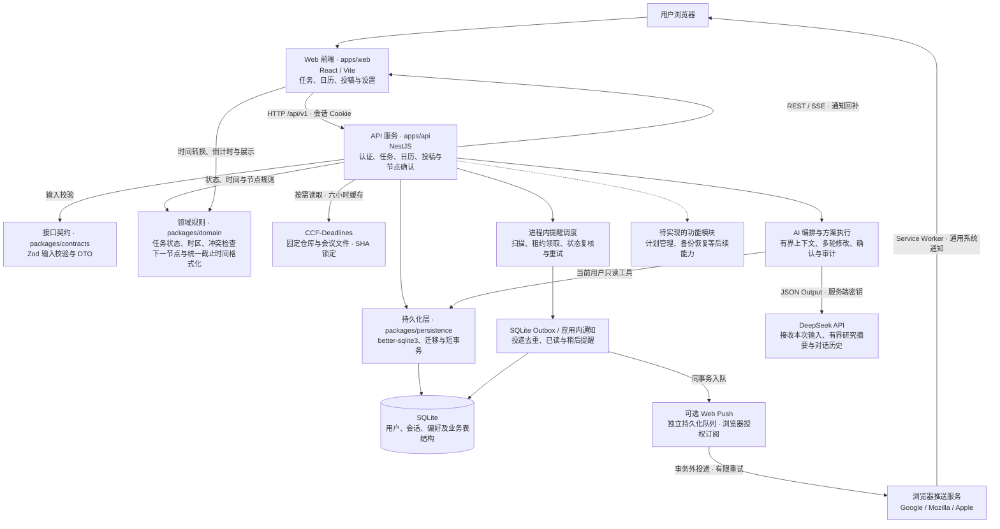

# Research Tasks

以 AI native 为基本原则，面向个人科研工作的任务、日历、投稿节点与提醒工具。正式应用采用 React / TypeScript、NestJS 和 SQLite，首版按单实例部署。

## 产品原则：AI native

以下原则适用于整个项目，作为后续功能设计与实现的依据；具体能力的完成情况见下文。

- 用户通过自然语言表达目标与约束，AI 理解意图、拆解任务、推荐安排，并协助调整任务、日历、投稿计划和提醒。
- AI 结合当前账户的真实任务、日程、工作时间和投稿节点生成方案；查询展示真实记录，安排检查时间与冲突，缺少关键信息时追问。
- 主要交互围绕“表达目标 → 生成方案 → 预览或修改 → 确认执行 → 展示结果”展开。表单用于精确调整和手动兜底，避免重复的创建入口及不必要的二次提交。
- 业务变更通过受校验的领域 API 执行，明确展示影响；确认后才写入，并处理冲突与重复请求。AI 解析成功与实际执行成功分别展示。
- AI 不可用时保留输入并允许重试，已有数据仍可查看和手动维护。

## 当前实现状态

已实现工程入口、SQLite 迁移与短事务，以及用户名/口令登录、12 小时会话、退出、CSRF 校验和用户偏好设置。正式 Web 的任务、课题、日历和投稿页面均使用真实 API，支持固定事件、工作块、准备任务、投稿阶段与独立截止节点。新建投稿默认提供 CCF A 类相关顶会选择，可预览并带入截止节点。已支持服务端持久化提醒、应用内通知和可选 Web Push；已接入 DeepSeek 统一方案工作流：多轮修改、真实研究上下文、任务/课题/日历/投稿/提醒的白名单操作、批量确认和执行审计；已有投稿支持来源更新比较与逐项确认应用。

项目类型检查与前后端构建通过。正式 better-sqlite3 驱动和迁移、认证服务及 NestJS HTTP 请求测试已验证。本地浏览器已验证任务/课题/日历/投稿流程、节点修改确认、来源与双时区展示、归档恢复、深链刷新、版本冲突保留输入，提醒创建/修改/取消、关闭浏览器后派发、通知已读/稍后提醒及 SSE 断开后的 GET 回补，以及 1440、1180、900、600 px 布局。定向检查覆盖用户隔离、幂等、事务回滚、夏令时、纯日期与秒精度、阶段与期限分离和重启后恢复。Staging 尚未验收。

原高保真原型保留在 `prototype/`，与正式应用的数据互不混用。 正式界面以 `prototype/dist` 及页面截图为视觉基准：保留任务分类导航、今天页的小日历和近期安排、任务时间/勾选列、居中的全宽列表、右侧详情抽屉和投稿阶段进度条；正式界面的日期、记录与来源仍由真实账户数据驱动。

## 系统架构

系统采用前后端分离开发、单实例部署的结构。实线表示当前调用或依赖关系，虚线表示规划中的接入关系。



开发环境由 Vite 将 `/api` 请求代理至 NestJS；生产构建后，NestJS 同时提供 Web 静态资源和 API。SQLite 保存于本地持久化磁盘，应用启动时执行版本化迁移。任务和课题写入在短事务内检查所有权、版本与幂等键；图中的待实现功能尚未形成完整业务流程。

## 任务工作流

- 只填标题可快速记录到收集箱；详情可编辑类型、状态、优先级、期限、课题、预计时长、备注和外部链接。
- 今天显示用户时区下今天到期、逾期、有当天工作块的任务，以及今天已完成的任务。设置截止时间不会自动安排工作块。
- 全部任务支持关键词、类型、状态、优先级、课题、截止日期和归档筛选，并按游标分页加载。
- 支持完成、重新打开、归档和确认删除；删除后可通过提示条撤销，服务端保留 24 小时恢复期限。版本冲突时保留编辑内容，由用户选择刷新最新版本。
- 课题支持新增、重命名和删除；删除课题只移除任务关联，不删除任务。

## 日历工作流

- 支持日、周、月视图；点击具体日期或时段创建新任务与工作块、安排已有任务，或创建固定事件。日历顶部不提供重复的添加入口。
- 事件可同时创建关联的会议准备任务；任务和工作块、事件和准备任务分别在同一短事务中提交，失败不留下半条记录。
- 半开区间 `[start, end)` 首尾相接不冲突。重叠时列出当前冲突，必须明确确认；候选时间或冲突记录版本变化后重新确认。
- 事件与工作块支持详情深链、版本校验、编辑及移除。取消工作块不修改任务期限；删除事件保留准备任务。任务详情提供关联工作块的日历链接。
- 日期型期限作为日期展示；精确时刻按用户时区展示。本地时间转换使用 Temporal，夏令时缺失时刻会拒绝保存，重复时刻需提供有效偏移。

## 投稿工作流

- 新建投稿默认从 [CCF-Deadlines](https://github.com/ccfddl/ccf-deadlines) 提供相关 CCF A 类会议，支持系统、AI、边缘智能、SNN 相关方向、关键词和年份筛选。方向标签由应用整理；也可切换手动创建。
- 选择会议后先预览年份、轮次、截止节点、原始时间与来源，点击创建才一次性保存投稿及节点。TBD 保持待定，缺少时区的精确时间不允许导入，导入不会自动标记为官网已核实。
- 目录按需更新并缓存六小时，网络失败时使用带抓取时间与提交版本的本地快照。投稿保留提交 SHA、文件链接和原始及已接受来源快照；重复选择会打开已有投稿，保留手动修订，不自动覆盖截止时间。
- 已绑定来源的投稿可在详情点击“检查来源更新”，强制检查固定仓库并锁定 SHA。预览对照上次接受的来源、当前本地和远端，展示截止时间、节点类型、来源/官网链接、核实状态及提醒影响；旧记录推断绑定和歧义均明确提示。
- 各节点默认保留本地，可逐项选择采用。上游移除不删除本地节点，本地已删除节点仅在明确选择恢复后重建；手工节点与未选择字段不自动覆盖。离线缓存、来源不完整、映射歧义或预览版本过期时阻止应用。
- 来源更新提案30分钟有效，确认在同一事务中校验版本、更新选择的节点并记录决定审计；重复确认不重复写入。保存原始及后续已接受 SHA 的原始 YAML 快照和每节点基线，部分接受不代表全部节点都采用该版本。相对提醒仅在确认后由调度复核重算；改成待定时取消无法计算的相对提醒，固定时刻提醒保留。
- 支持会议/期刊名称、年份、轮次、投稿阶段、投稿与草稿链接、下一步行动，以及关键词、阶段、年份和归档筛选。
- 摘要、全文、答辩、结果通知、最终稿等节点独立保存。节点可为待定、纯日期或精确时刻；待定不会自动补成今天，阶段更新不会改写节点时间。
- 保留原始来源时区、来源链接、官网链接和用户明确填写的核实时间。精确时刻同时显示来源时间与当前用户时区，保留秒和 UTC 偏移。
- 修改已有节点先展示服务器标准化的前后对比，经明确确认和版本校验后写入。旧版本冲突保留输入，由用户选择刷新；删除节点另需确认。
- 投稿列表与详情根据实际当前时间选择下一节点并显示倒计时，已过期节点显示“已截止”。投稿列表、详情和日历共用截止时间格式化规则，日历节点可跳转到对应投稿。
- 归档投稿会保留节点与来源，并从正在跟进的列表和日历隐藏；可在已归档列表恢复。新增、修改、归档和删除均校验所有权、版本和幂等键。

## 提醒与通知

- 在任务详情、日历事件详情或投稿截止节点中创建提醒；支持指定时刻，或按目标期限设置提前分钟数。日期型期限必须明确基准时刻与时区，待定期限不自动生成相对提醒。
- 尚未触发的相对提醒会跟随期限调整；指定时刻保持不变。已完成、取消、归档或删除的目标不会继续派发。已发送提醒不会因改期自动重放。
- 提醒与 Outbox 在同一短事务中保存。进程内单个调度器每轮结束后再等待五秒扫描；投递前复核目标与版本，通知通过唯一键去重，租约过期后可恢复。失败最多尝试五次，错误状态可在目标提醒列表查看并重新安排。
- 关闭通知偏好会暂停派发，重新开启后处理待发送提醒。静音模式在用户时区的 22:00–08:00 延后派发；已有通知仍可查看。
- 顶部通知中心显示未读数，支持标记已读、10 分钟后提醒、分页和目标跳转。SSE 提供刷新信号，GET 与轮询负责历史回补；关闭浏览器后服务端继续处理，重新登录可查看通知。应用服务停止期间不派发，重启后处理到期项。
- 可在“设置 → 通知 → 浏览器推送”主动开启或停用此浏览器的 Web Push。未授权、浏览器不支持或服务端未配置时，应用内通知继续工作。系统通知仅显示通用文案，点击后进入需登录的目标页面。
- 推送订阅绑定当前登录会话；退出或 12 小时会话到期后停止新的外部投递，重新登录需主动开启。静音与通知偏好在外部发送前再次检查，已读或已失效目标跳过。
- 推送发送使用独立持久化队列，网络操作在 SQLite 事务外执行；临时错误最多尝试五次，404/410 订阅停用。稳定消息标识用于通知合并，外部发送按至少一次重试，推送服务接受不表示用户已阅读。已被服务商接受的通知可能在停用后到达。
- 本地已验证订阅 API、队列/重启恢复及浏览器 Service Worker；真实供应商到设备的投递和 Staging 仍待验收。

## AI 查询与方案执行

- Today、收集箱、全部任务、日历和投稿提供自然语言入口，资源详情可携带当前目标。顶部入口及 Ctrl/Cmd + K 使用相同 AI 助手，也可切换页面导航搜索；手工维护作为兜底保留。
- 提交页面输入后自动生成方案。可直接继续说“缩短到半小时”“改到明天”或补充上一轮追问。服务端按账户读取最近八轮历史，并带入已执行方案的实际记录 ID，帮助后续修改定位原记录。
- 上下文只包含当前账户的有界研究摘要：最多60项任务、30项课题、20项投稿、120项未来31天日历记录、40项提醒；任务工作块与投稿节点也有限额。详情目标可单独带入。规划依据和截断提示在预览中展示，范围外记录需打开详情后再操作。既有自由备注、URL、凭据和其他账户数据不进入摘要；用户本次输入和对话中的方案内容会发送给 DeepSeek。
- 支持创建/修改任务与课题、安排已有任务工作块、调整工作块、创建/修改固定事件及准备任务、创建投稿和用户给出的节点、调整投稿阶段与下一步、拆解投稿准备任务，以及创建/调整/取消提醒。现有会议来源与权威截止节点的更新仍通过专用人工核对流程进行。
- 模型负责意图、任务拆解与方案说明，程序按真实日历和工作时间计算空档。新任务可明确指定时段或日期；自动建议默认查找未来七天，未指定有效时长时明确暂按30分钟。没有合适空档时仅创建未安排任务并提示。开始时间和截止期限分别保存，不自动互相替代。
- 每个方案最多12项操作，展示目标、修改前后影响、附带准备任务、假设与提醒政策。继续修改会生成新方案并使旧方案失效；确认只执行服务端保存的方案，客户端不能替换动作。方案30分钟过期，时段已经开始、目标版本变化或新冲突都会阻止写入，需重新生成。
- 确认通过既有受保护领域服务，在同一 SQLite 事务中执行全部操作并保存执行结果与逐项审计；任一步失败全部回滚。相同方案重复确认返回已有结果。查询、追问和未确认方案不写业务记录，成功后展示实际资源链接。
- 使用 DeepSeek JSON Output 和服务端 Zod 白名单校验，不允许模型执行 SQL、代码或抓取用户 URL。提供 SSE 进度及 GET 回补、停止解析、错误输入保留；重启后中断未完成解析，不自动重放付费请求。未执行解析约24小时后按需清理，已执行方案及审计保留。
- 输入最多2000字符，输出最多4000 tokens，单次请求30秒；每用户每分钟最多5次、每小时60次，全局2个并发。可关闭 AI 新请求，普通业务操作仍可用。当前支持用户主动发起的有限方案，尚无后台自主调整或全量长期研究优化。

## 目录

- `apps/web/`：React/Vite 应用壳层、任务/课题/日历/投稿页面、登录与偏好设置。
- `apps/api/`：NestJS 认证、任务、日历、投稿与节点 API、顶会目录与原子导入、提醒与通知 API、调度器，以及健康检查。
- `packages/contracts/`：任务、日历、投稿 DTO 与 Zod 输入校验。
- `packages/domain/`：任务状态、Temporal 时间转换、冲突检查、下一节点与截止时间格式化。
- `packages/persistence/`：驱动无关的 SQLite 最小连接接口、迁移和短事务。正式启动注入 better-sqlite3。
- `infra/migrations/`：用户、会话、任务、项目、事件、工作块、投稿、提醒、Outbox、通知及会议来源快照表结构。
- `scripts/migrate.ts`：使用正式驱动运行迁移。
- `docs/superpowers/plans/2026-10-30-research-tasks-implementation.md`：完整计划及当前进度。

## 安装和运行

需要 Node.js 22.14 以上的 22.x，或 Node.js 24 以上，以及可访问 npm 的网络。首次运行：

```bash
corepack pnpm install
cp .env.example .env
corepack pnpm db:migrate
corepack pnpm account:create researcher
corepack pnpm dev
```

Web 默认地址 `http://127.0.0.1:5173`，API 默认地址 `http://127.0.0.1:3000`；Vite 将 `/api` 代理至 API。更改 API 的 PORT 时同步调整 Vite 代理。默认数据库为 `var/research-tasks.sqlite`，路径相对仓库根目录，不在静态资源目录中。

创建账号命令会隐藏输入并要求重复口令，口令须为 12–128 个字符。不要将真实口令写进命令参数或 `.env`；不开放公开注册。账号名会转为小写，支持 3–32 位字母、数字、点、下划线和连字符。

开发时使用 `http://127.0.0.1:5173`，与 `.env` 中的 `APP_ORIGIN` 保持一致；生产需配置精确的 HTTPS Origin，Cookie 才能正常安全使用。

可运行 `corepack pnpm build` 和 `corepack pnpm typecheck`。生产构建后由 API 提供 `apps/web/dist/`；入口为 `corepack pnpm --filter @research/api start`。当前未配置生产部署。

## DeepSeek 配置

在 API 服务进程环境或本地 `.env` 中配置 `DEEPSEEK_API_KEY`，设置 `AI_PROVIDER=deepseek`，可通过 `AI_MODEL` 选择模型，默认 `deepseek-flash`。修改进程环境后重启 API。密钥不进入前端响应、日志或版本库；缺少密钥时 AI 入口明确提示未配置，页面导航和普通业务仍可用。

模型使用官方固定 HTTPS 接口，关闭思考模式，并请求 [DeepSeek JSON Output](https://api-docs.deepseek.com/guides/json_mode/)；JSON 有效后仍需要通过应用字段校验。本地已使用真实 DeepSeek 请求验证任务查询意图（HTTP 200），浏览器规则与错误场景使用固定替身验证。

## 可选浏览器推送配置

默认不启用外部推送。安装依赖后运行 `corepack pnpm push:keys` 生成一对密钥，将输出的 `PUSH_VAPID_PUBLIC_KEY`、`PUSH_VAPID_PRIVATE_KEY` 及真实联系地址 `PUSH_VAPID_SUBJECT` 填入服务端 `.env`，重启 API。私钥只保存在服务端；密钥对需保持稳定，轮换后浏览器需重新订阅。未配置完整、格式无效或密钥不匹配时，API 保持可用并关闭推送入口。

生产浏览器需要 HTTPS 与支持 Push API 的浏览器，本机开发可使用 `127.0.0.1` 或 `localhost`，并与 `APP_ORIGIN` 保持一致。当前仅允许 `fcm.googleapis.com`、`updates.push.services.mozilla.com`、`web.push.apple.com` 的标准 HTTPS 订阅地址。Service Worker 不缓存业务页面或账号数据。实现使用 [web-push](https://github.com/web-push-libs/web-push) 和浏览器 [Push API](https://developer.mozilla.org/en-US/docs/Web/API/Push_API)。

## 验证

```bash
npm run test:foundation
corepack pnpm --filter @research/web test
corepack pnpm test:integration
```

`test:foundation` 使用 Node 自带 TypeScript 类型擦除与 `node:sqlite`，在临时文件中运行真实 SQLite 行为测试；不会写入应用数据库。`node:sqlite` 在 Node 22 中的实验性提示属于运行时提示。Web 的 `test` 验证路由、API 错误与冲突详情、CSRF、会话失效及请求取消。基础用例不代替正式驱动验证；`test:integration` 构建共享包与 API，验证时区、下一节点与统一格式化，并以 better-sqlite3 临时库验证认证、任务/课题/日历/投稿 CRUD、节点确认与来源保留、顶会目录解析、重复导入保护、来源三方比较与选择性更新、提醒去重/静音/重试/租约恢复、推送订阅及队列、AI 结构化校验/上下文隔离/连续修改/批量原子确认与审计/取消/中断恢复、所有权、版本、幂等、事务、冲突确认、日期与工作块分离、归档恢复、生产页面路由回退和账号创建 CLI。HTTP 测试不绑定网络端口。

用例验证任务状态转换、逾期判断、有效日历日期、AoE 秒精度、半开区间冲突，以及 SQLite 迁移重入/校验、事务回滚、异步事务拒绝、外键、跨用户关联、期限互斥与有界写锁等待。

地区时区的本地时间转换采用 [Temporal polyfill](https://github.com/js-temporal/temporal-polyfill)，支持 PT 到 `America/Los_Angeles`、AoE 到 `Etc/GMT+12` 的明确映射并保留秒精度。单独的固定偏移工具仍拒绝 PT，避免把地区时区误当成固定 UTC−8。

## 数据与配置

- 数据库启用 WAL、外键、FULL 同步和有界锁等待。事务回调必须同步；模型请求和外部通知不得放在持锁事务内。
- 数据库、WAL/SHM、`.env` 和备份不提交到版本库。原型 `prototype/dist/` 是保留源码，未被构建目录忽略规则排除。
- SQLite 文件需要持久化本地磁盘，不使用网络共享文件或多副本写入。
- 暂无备份恢复命令；运行中的 WAL 数据库不能只复制主文件充当完整备份。计划 Task 14 将实现一致性备份和恢复流程。
- 登录采用用户名/口令，不使用 OIDC。口令使用带随机盐的 Node scrypt（N=32768、r=8、p=3），参数参考 [OWASP Password Storage](https://cheatsheetseries.owasp.org/cheatsheets/Password_Storage_Cheat_Sheet.html#scrypt)。数据库只存口令哈希和会话令牌哈希。
- 登录失败按连接 IP 限流，哈希并发限制为 2；若后续部署在共享反向代理之后，需先确定可信代理与真实客户端地址策略。
- DeepSeek 仅从服务端环境读取密钥；生成方案与执行分离。业务变更须用户明确确认，经过版本、所有权和冲突校验后原子写入。
