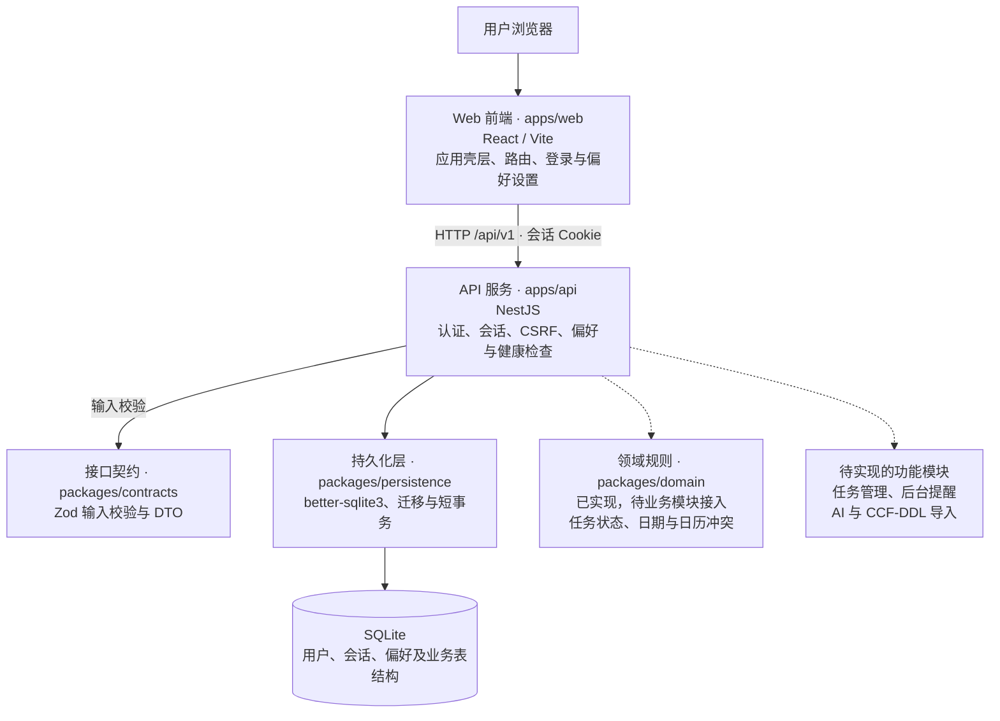

# Research Tasks

面向个人科研工作的任务、日历、投稿节点与提醒工具。正式应用采用 React / TypeScript、NestJS 和 SQLite，首版按单实例部署。

## 当前实现状态

已实现工程入口、SQLite 迁移与短事务，以及用户名/口令登录、12 小时会话、退出、CSRF 校验和用户偏好设置。正式 Web 已接入应用壳层、侧栏导航、页面深链、页面导航搜索和分组偏好设置；任务管理、后台提醒、真实 AI 和 CCF-DDL 导入仍待实现，对应页面明确显示待接入状态。

项目类型检查与前后端构建通过。正式 better-sqlite3 驱动和迁移、认证服务及 NestJS HTTP 请求测试已验证。本地浏览器已验证登录、偏好持久化、退出、切换账户、会话过期、导航与深链刷新、弹窗键盘操作，以及 1440、1180、900、600 px 布局。Staging 尚未验收，PT/IANA 地区时区适配仍待实现。

原高保真原型保留在 `prototype/`，与正式应用的数据互不混用。

## 系统架构

系统采用前后端分离开发、单实例部署的结构。实线表示当前调用或依赖关系，虚线表示规划中的接入关系。



开发环境由 Vite 将 `/api` 请求代理至 NestJS；生产构建后，NestJS 同时提供 Web 静态资源和 API。SQLite 保存于本地持久化磁盘，应用启动时执行版本化迁移。领域规则与业务表结构已建立，图中的待实现功能尚未形成完整业务流程。

## 目录

- `apps/web/`：React/Vite 应用壳层、页面路由、登录与偏好设置。
- `apps/api/`：NestJS 应用入口、数据库生命周期、`/api/v1/health` 和 `/api/v1/ready`。
- `packages/contracts/`：Zod 任务输入与基础响应契约。
- `packages/domain/`：任务状态、纯日期、固定偏移时间及日历区间规则。
- `packages/persistence/`：驱动无关的 SQLite 最小连接接口、迁移和短事务。正式启动注入 better-sqlite3。
- `infra/migrations/`：用户、会话、任务、项目、事件、工作块、投稿、提醒、Outbox 和通知的初始表结构。
- `scripts/migrate.ts`：使用正式驱动运行迁移。
- `docs/superpowers/plans/2026-10-30-research-tasks-implementation.md`：完整计划及当前进度。

## 安装和运行

需要 Node.js 22.14 以上的 22.x，或 Node.js 24 以上，以及可访问 npm 的网络。首次运行：

```bash
corepack pnpm install
cp .env.example .env
corepack pnpm db:migrate
corepack pnpm account:create researcher
corepack pnpm dev
```

Web 默认地址 `http://127.0.0.1:5173`，API 默认地址 `http://127.0.0.1:3000`；Vite 将 `/api` 代理至 API。更改 API 的 PORT 时同步调整 Vite 代理。默认数据库为 `var/research-tasks.sqlite`，路径相对仓库根目录，不在静态资源目录中。

创建账号命令会隐藏输入并要求重复口令，口令须为 12–128 个字符。不要将真实口令写进命令参数或 `.env`；不开放公开注册。账号名会转为小写，支持 3–32 位字母、数字、点、下划线和连字符。

开发时使用 `http://127.0.0.1:5173`，与 `.env` 中的 `APP_ORIGIN` 保持一致；生产需配置精确的 HTTPS Origin，Cookie 才能正常安全使用。

可运行 `corepack pnpm build` 和 `corepack pnpm typecheck`。生产构建后由 API 提供 `apps/web/dist/`；入口为 `corepack pnpm --filter @research/api start`。当前未配置生产部署。

## 验证

```bash
npm run test:foundation
corepack pnpm --filter @research/web test
corepack pnpm test:integration
```

`test:foundation` 使用 Node 自带 TypeScript 类型擦除与 `node:sqlite`，在临时文件中运行真实 SQLite 行为测试；不会写入应用数据库。`node:sqlite` 在 Node 22 中的实验性提示属于运行时提示。Web 的 `test` 验证路由匹配、API 错误、CSRF、会话失效及请求取消。基础用例不代替正式驱动验证；`test:integration` 会构建共享包与 API，并以 better-sqlite3 临时库验证持久化、认证、Cookie、CSRF、退出、生产页面路由回退和账号创建 CLI。HTTP 测试不绑定网络端口。

用例验证任务状态转换、逾期判断、有效日历日期、AoE 秒精度、半开区间冲突，以及 SQLite 迁移重入/校验、事务回滚、异步事务拒绝、外键、跨用户关联、期限互斥与有界写锁等待。

PT / IANA 地区时区的归一化尚未实现；固定偏移工具会拒绝 PT，不将其误判为 UTC−8。后续按计划接入时间库并验证夏令时歧义。

## 数据与配置

- 数据库启用 WAL、外键、FULL 同步和有界锁等待。事务回调必须同步；模型请求和外部通知不得放在持锁事务内。
- 数据库、WAL/SHM、`.env` 和备份不提交到版本库。原型 `prototype/dist/` 是保留源码，未被构建目录忽略规则排除。
- SQLite 文件需要持久化本地磁盘，不使用网络共享文件或多副本写入。
- 暂无备份恢复命令；运行中的 WAL 数据库不能只复制主文件充当完整备份。计划 Task 14 将实现一致性备份和恢复流程。
- 登录采用用户名/口令，不使用 OIDC。口令使用带随机盐的 Node scrypt（N=32768、r=8、p=3），参数参考 [OWASP Password Storage](https://cheatsheetseries.owasp.org/cheatsheets/Password_Storage_Cheat_Sheet.html#scrypt)。数据库只存口令哈希和会话令牌哈希。
- 登录失败按连接 IP 限流，哈希并发限制为 2；若后续部署在共享反向代理之后，需先确定可信代理与真实客户端地址策略。
- 模型配置尚未接入，不填充虚构凭据，不在日志或提交中暴露真实密钥。
