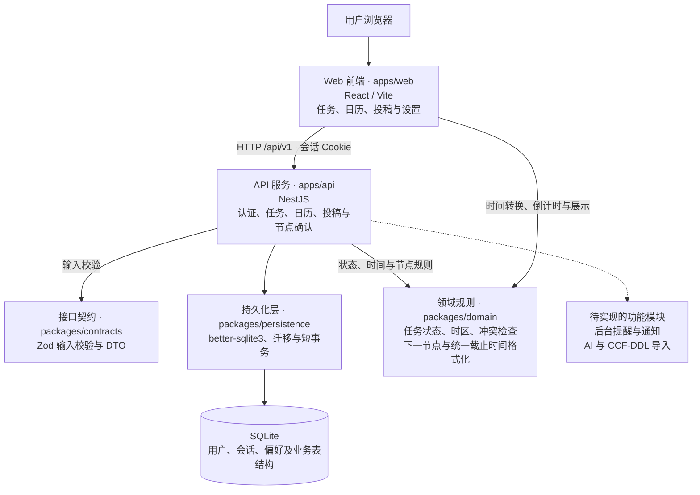

# Research Tasks

面向个人科研工作的任务、日历、投稿节点与提醒工具。正式应用采用 React / TypeScript、NestJS 和 SQLite，首版按单实例部署。

## 当前实现状态

已实现工程入口、SQLite 迁移与短事务，以及用户名/口令登录、12 小时会话、退出、CSRF 校验和用户偏好设置。正式 Web 的任务、课题、日历和投稿页面均使用真实 API，支持固定事件、工作块、准备任务、投稿阶段与独立截止节点。后台提醒、真实 AI 和 CCF-DDL 导入仍待实现。

项目类型检查与前后端构建通过。正式 better-sqlite3 驱动和迁移、认证服务及 NestJS HTTP 请求测试已验证。本地浏览器已验证任务/课题/日历/投稿流程、节点修改确认、来源与双时区展示、归档恢复、深链刷新、版本冲突保留输入，以及 1440、1180、900、600 px 布局。定向检查覆盖用户隔离、幂等、事务回滚、夏令时、纯日期与秒精度、阶段与期限分离和重启后恢复。Staging 尚未验收。

原高保真原型保留在 `prototype/`，与正式应用的数据互不混用。

## 系统架构

系统采用前后端分离开发、单实例部署的结构。实线表示当前调用或依赖关系，虚线表示规划中的接入关系。



开发环境由 Vite 将 `/api` 请求代理至 NestJS；生产构建后，NestJS 同时提供 Web 静态资源和 API。SQLite 保存于本地持久化磁盘，应用启动时执行版本化迁移。任务和课题写入在短事务内检查所有权、版本与幂等键；图中的待实现功能尚未形成完整业务流程。

## 任务工作流

- 只填标题可快速记录到收集箱；详情可编辑类型、状态、优先级、期限、课题、预计时长、备注和外部链接。
- 今天显示用户时区下今天到期、逾期、有当天工作块的任务，以及今天已完成的任务。设置截止时间不会自动安排工作块。
- 全部任务支持关键词、类型、状态、优先级、课题、截止日期和归档筛选，并按游标分页加载。
- 支持完成、重新打开、归档和确认删除；删除后可通过提示条撤销，服务端保留 24 小时恢复期限。版本冲突时保留编辑内容，由用户选择刷新最新版本。
- 课题支持新增、重命名和删除；删除课题只移除任务关联，不删除任务。

## 日历工作流

- 支持日、周、月视图；点击具体日期或时段创建新任务与工作块、安排已有任务，或创建固定事件。日历顶部不提供重复的添加入口。
- 事件可同时创建关联的会议准备任务；任务和工作块、事件和准备任务分别在同一短事务中提交，失败不留下半条记录。
- 半开区间 `[start, end)` 首尾相接不冲突。重叠时列出当前冲突，必须明确确认；候选时间或冲突记录版本变化后重新确认。
- 事件与工作块支持详情深链、版本校验、编辑及移除。取消工作块不修改任务期限；删除事件保留准备任务。任务详情提供关联工作块的日历链接。
- 日期型期限作为日期展示；精确时刻按用户时区展示。本地时间转换使用 Temporal，夏令时缺失时刻会拒绝保存，重复时刻需提供有效偏移。

## 投稿工作流

- 支持会议/期刊名称、年份、轮次、投稿阶段、投稿与草稿链接、下一步行动，以及关键词、阶段、年份和归档筛选。
- 摘要、全文、答辩、结果通知、最终稿等节点独立保存。节点可为待定、纯日期或精确时刻；待定不会自动补成今天，阶段更新不会改写节点时间。
- 保留原始来源时区、来源链接、官网链接和用户明确填写的核实时间。精确时刻同时显示来源时间与当前用户时区，保留秒和 UTC 偏移。
- 修改已有节点先展示服务器标准化的前后对比，经明确确认和版本校验后写入。旧版本冲突保留输入，由用户选择刷新；删除节点另需确认。
- 投稿列表与详情根据实际当前时间选择下一节点并显示倒计时，已过期节点显示“已截止”。投稿列表、详情和日历共用截止时间格式化规则，日历节点可跳转到对应投稿。
- 归档投稿会保留节点与来源，并从正在跟进的列表和日历隐藏；可在已归档列表恢复。新增、修改、归档和删除均校验所有权、版本和幂等键。

## 目录

- `apps/web/`：React/Vite 应用壳层、任务/课题/日历/投稿页面、登录与偏好设置。
- `apps/api/`：NestJS 认证、任务、日历、投稿与节点 API，以及健康检查。
- `packages/contracts/`：任务、日历、投稿 DTO 与 Zod 输入校验。
- `packages/domain/`：任务状态、Temporal 时间转换、冲突检查、下一节点与截止时间格式化。
- `packages/persistence/`：驱动无关的 SQLite 最小连接接口、迁移和短事务。正式启动注入 better-sqlite3。
- `infra/migrations/`：用户、会话、任务、项目、事件、工作块、投稿、提醒、Outbox 和通知的初始表结构。
- `scripts/migrate.ts`：使用正式驱动运行迁移。
- `docs/superpowers/plans/2026-10-30-research-tasks-implementation.md`：完整计划及当前进度。

## 安装和运行

需要 Node.js 22.14 以上的 22.x，或 Node.js 24 以上，以及可访问 npm 的网络。首次运行：

```bash
corepack pnpm install
cp .env.example .env
corepack pnpm db:migrate
corepack pnpm account:create researcher
corepack pnpm dev
```

Web 默认地址 `http://127.0.0.1:5173`，API 默认地址 `http://127.0.0.1:3000`；Vite 将 `/api` 代理至 API。更改 API 的 PORT 时同步调整 Vite 代理。默认数据库为 `var/research-tasks.sqlite`，路径相对仓库根目录，不在静态资源目录中。

创建账号命令会隐藏输入并要求重复口令，口令须为 12–128 个字符。不要将真实口令写进命令参数或 `.env`；不开放公开注册。账号名会转为小写，支持 3–32 位字母、数字、点、下划线和连字符。

开发时使用 `http://127.0.0.1:5173`，与 `.env` 中的 `APP_ORIGIN` 保持一致；生产需配置精确的 HTTPS Origin，Cookie 才能正常安全使用。

可运行 `corepack pnpm build` 和 `corepack pnpm typecheck`。生产构建后由 API 提供 `apps/web/dist/`；入口为 `corepack pnpm --filter @research/api start`。当前未配置生产部署。

## 验证

```bash
npm run test:foundation
corepack pnpm --filter @research/web test
corepack pnpm test:integration
```

`test:foundation` 使用 Node 自带 TypeScript 类型擦除与 `node:sqlite`，在临时文件中运行真实 SQLite 行为测试；不会写入应用数据库。`node:sqlite` 在 Node 22 中的实验性提示属于运行时提示。Web 的 `test` 验证路由、API 错误与冲突详情、CSRF、会话失效及请求取消。基础用例不代替正式驱动验证；`test:integration` 构建共享包与 API，验证时区、下一节点与统一格式化，并以 better-sqlite3 临时库验证认证、任务/课题/日历/投稿 CRUD、节点确认与来源保留、所有权、版本、幂等、事务、冲突确认、日期与工作块分离、归档恢复、生产页面路由回退和账号创建 CLI。HTTP 测试不绑定网络端口。

用例验证任务状态转换、逾期判断、有效日历日期、AoE 秒精度、半开区间冲突，以及 SQLite 迁移重入/校验、事务回滚、异步事务拒绝、外键、跨用户关联、期限互斥与有界写锁等待。

地区时区的本地时间转换采用 [Temporal polyfill](https://github.com/js-temporal/temporal-polyfill)，支持 PT 到 `America/Los_Angeles`、AoE 到 `Etc/GMT+12` 的明确映射并保留秒精度。单独的固定偏移工具仍拒绝 PT，避免把地区时区误当成固定 UTC−8。

## 数据与配置

- 数据库启用 WAL、外键、FULL 同步和有界锁等待。事务回调必须同步；模型请求和外部通知不得放在持锁事务内。
- 数据库、WAL/SHM、`.env` 和备份不提交到版本库。原型 `prototype/dist/` 是保留源码，未被构建目录忽略规则排除。
- SQLite 文件需要持久化本地磁盘，不使用网络共享文件或多副本写入。
- 暂无备份恢复命令；运行中的 WAL 数据库不能只复制主文件充当完整备份。计划 Task 14 将实现一致性备份和恢复流程。
- 登录采用用户名/口令，不使用 OIDC。口令使用带随机盐的 Node scrypt（N=32768、r=8、p=3），参数参考 [OWASP Password Storage](https://cheatsheetseries.owasp.org/cheatsheets/Password_Storage_Cheat_Sheet.html#scrypt)。数据库只存口令哈希和会话令牌哈希。
- 登录失败按连接 IP 限流，哈希并发限制为 2；若后续部署在共享反向代理之后，需先确定可信代理与真实客户端地址策略。
- 模型配置尚未接入，不填充虚构凭据，不在日志或提交中暴露真实密钥。
