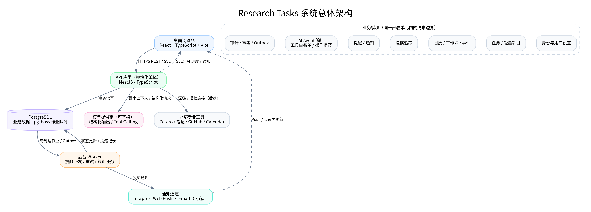
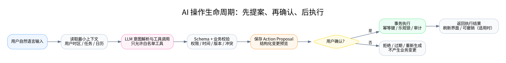
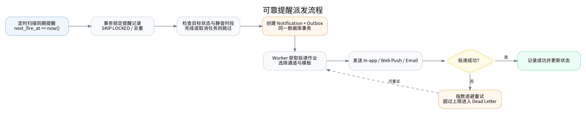
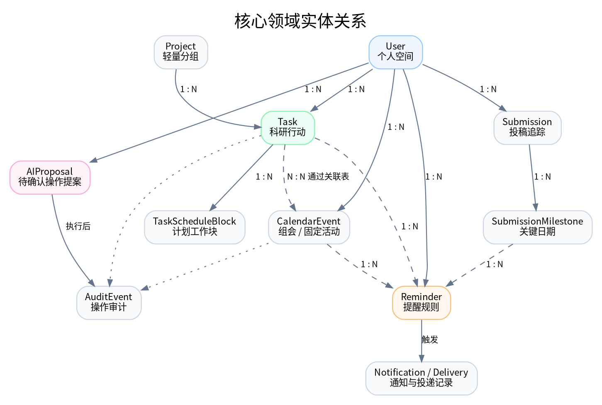

# 目录

1. 产品定位与系统边界
2. 需求与质量属性
3. 总体架构与技术决策
4. 关键运行流程
5. 领域模型
6. 数据库设计
7. 领域规则与状态机
8. API 设计
9. AI Agent 系统设计
10. 提醒与通知子系统
11. 外部集成策略
12. 身份、安全与隐私
13. 可观测性、可靠性与运维
14. 性能与扩展策略
15. 开发、部署与迁移
16. 测试策略
17. 分阶段实施计划
18. 关键风险与架构决策记录
19. 待决策事项
20. 上线前检查清单

# 文档信息

| 项目 | 内容 |
|---|---|
| 产品名称 | Research Tasks |
| 文档名称 | 系统设计文档（System Design） |
| 版本 | V1.0 |
| 状态 | 推荐架构基线，待技术选型评审后冻结 |
| 日期 | 2026-10-30 |
| 产品形态 | 桌面端 Web App |
| 核心用户 | 计算机科学与技术及相关方向的博士生、研究生 |
| 设计原则 | AI-native、安静、轻量、低干扰、任务优先 |
| 关联文档 |《Research Tasks 前端设计规范 V1.0》|

> **系统设计总纲：复杂的智能，简单的界面。** AI 负责理解意图、组织任务和提出计划；确定性的业务服务负责校验与执行；界面只呈现用户当前需要的信息，并始终保留用户的最终决定权。

本文件定义系统边界、逻辑架构、领域模型、数据库设计、API 契约、AI Agent 执行机制、日历排程、提醒派发、安全、部署、可观测性和测试策略。文中的技术栈和容量指标是推荐基线，并非已经采购或部署的事实。实施团队可以在不改变领域边界和安全约束的前提下替换具体产品。

# 1. 产品定位与系统边界

## 1.1 产品定位

Research Tasks 是一个 AI-native 的个人科研任务管理工具。它帮助博士生快速收集科研事项，安排工作时间，管理组会与学术活动，追踪论文投稿截止日期，并通过提醒和复盘降低遗漏与计划失控的概率。产品的价值不是保存科研资料，而是帮助用户把“接下来要做的事”变成可执行、可追踪的行动。

系统的核心数据是任务、时间安排、日历事件、投稿节点、提醒和执行状态。AI 是贯穿这些数据的自然语言交互与决策辅助层，不是独立于业务系统之外的聊天机器人。任何 AI 写操作都必须经过业务规则校验，并在适当的风险等级下获得用户确认。

## 1.2 明确不做的事情

本系统不实现论文 PDF 阅读、批注、引用管理和文献数据库；不实现 Markdown 知识库、双向链接和数学笔记；不实现代码托管、实验追踪、模型训练、GPU 调度或数据集版本管理；不实现论文协同写作、审稿文件管理或实验室 ERP。上述能力由 Zotero、Zettlr、GitHub/GitLab、实验平台、Overleaf 等专业软件负责。

本系统只保留外部资源的链接、提供商标识和可选外部 ID，以便用户从任务跳转到专业工具。除非用户明确授权并且存在稳定的官方 API，系统不得为了“增强 AI 上下文”而默认抓取外部文档内容。

## 1.3 产品内的功能边界

| 领域 | 系统负责 | 系统不负责 |
|---|---|---|
| 科研任务 | 创建、分类、安排、延期、状态与提醒 | 复杂项目计划、团队工时考核 |
| 实验 | 管理“何时做、何时完成、当前状态” | 实验配置、运行日志、结果存储 |
| 论文阅读 | 管理待读任务、阅读进度和外部链接 | PDF、摘要库、引用和阅读笔记 |
| 知识学习 | 管理学习任务和复习提醒 | 知识文档、课程内容、题库 |
| 组会 | 管理会议时间、提醒和关联准备任务 | 会议纪要文档和团队会议协作 |
| 投稿 | 管理会议/期刊、阶段和关键日期 | 论文文件、投稿系统和审稿材料 |
| AI | 解析意图、查询、生成计划提案和复盘 | 未经授权自主改写用户日程或删除数据 |

## 1.4 目标与非目标

首要目标是让用户更快完成任务录入、更容易知道今天应该做什么、更少错过关键截止日期，并能用自然语言查询和调整计划。非目标是追求复杂的可视化报表、组织级权限、科研绩效评价、团队项目管理或大而全的知识管理。

# 2. 需求与质量属性

## 2.1 核心功能需求

| 编号 | 需求 | 说明 | 优先级 |
|---|---|---|---|
| FR-01 | 快速收集 | 允许用户只输入标题，将事项先放入 Inbox | P0 |
| FR-02 | 统一任务 | 统一管理实验、论文阅读、知识学习、科研杂项和个人事项 | P0 |
| FR-03 | 时间管理 | 支持截止时间、预计耗时、日历工作块和延期 | P0 |
| FR-04 | 日历事件 | 管理组会、学术报告等固定时间事件 | P0 |
| FR-05 | 投稿追踪 | 管理投稿阶段、官方截止时间和关键里程碑 | P0 |
| FR-06 | 提醒通知 | 具备服务端调度、应用内通知和可扩展的推送通道 | P0 |
| FR-07 | AI 任务创建 | 将自然语言转为结构化任务提案 | P0 |
| FR-08 | AI 查询 | 查询任务、日历、近期安排和逾期事项 | P0 |
| FR-09 | AI 排程 | 根据日历空档、任务时长和截止日期生成可确认的计划 | P1 |
| FR-10 | AI 拆解与复盘 | 将目标拆成任务，生成日/周复盘 | P1 |
| FR-11 | 外部链接 | 关联文献、笔记、代码和实验平台链接 | P0 |
| FR-12 | 导出与删除 | 导出个人数据，支持账户和数据删除 | P1 |

## 2.2 非功能需求

| 质量属性 | 目标设计 | 验收关注点 |
|---|---|---|
| 可用性 | 页面简单，核心任务操作路径短 | 快速创建只要求标题；常见操作不需多层导航 |
| 正确性 | 业务写操作由服务端事务执行 | AI 不得凭文本回复伪造成功状态 |
| 提醒可靠性 | 服务端持久化调度与重试 | 浏览器关闭后，不依赖前端计时器 |
| 时间正确性 | 统一处理 UTC、IANA 时区和纯日期 | 跨时区、夏令时、全天事件测试通过 |
| 安全性 | 用户数据隔离、最小权限、敏感信息保护 | 所有读写均按身份进行所有权校验 |
| 可维护性 | 模块化单体、清晰领域边界 | 业务模块可单独测试，避免跨模块直接写表 |
| 可扩展性 | API、模型提供商和通知通道可替换 | 不将 LLM 厂商绑定到领域模型 |
| 可观测性 | 结构化日志、指标、追踪和审计 | 能定位提醒延迟、AI 失败和 API 异常 |

## 2.3 建议的初期服务目标

首版服务目标以个人科研工具的可用性为准，不应为了未经验证的高并发目标提前引入复杂架构。建议将普通读写 API 的服务端 p95 延迟控制在 500 ms 以内（不含模型推理和第三方服务等待）；对到期提醒，建议以触发时间后 60 秒内进入投递流程作为初始 p95 目标；AI 首 token/完整响应时间单独统计，不与普通 API 混算。初始可用性目标可设为 99.5%，在真实用户量和提醒可靠性数据积累后再调整。

# 3. 总体架构与技术决策

## 3.1 架构风格

建议采用**模块化单体（Modular Monolith）+ 独立后台 Worker**。API 与 Worker 可以由同一代码仓库、同一领域模块构建成不同运行进程。首版不拆分微服务，不引入 Kubernetes、Redis 集群或复杂消息平台，除非部署规模或可靠性要求已经证明其必要性。

模块化单体的优势在于任务、日历、提醒和 AI 操作之间有清晰边界，同时可以通过同一 PostgreSQL 事务完成一致性写入。它比微服务更容易本地调试、部署和迁移，也避免早期把时间花在分布式追踪、跨服务事务和版本兼容上。

## 3.2 总体逻辑架构



浏览器中的 React 应用通过 HTTPS REST API 读写业务数据，并通过 SSE 接收 AI 执行进度和通知状态。API 应用负责认证、权限、领域校验、AI 编排和事务提交。PostgreSQL 是唯一业务事实来源，同时可以承载初期的持久化作业队列。后台 Worker 负责提醒扫描、通知投递、重试和周期性复盘等异步工作。AI 模型通过 Provider Adapter 接入，不直接访问数据库。外部专业工具在 MVP 阶段以深链为主。

## 3.3 推荐技术栈

| 层 | 推荐选型 | 说明 |
|---|---|---|
| Web 前端 | React + TypeScript + Vite | 与前端设计规范保持一致 |
| UI 状态 | TanStack Query + 轻量 Zustand/Context | 服务端数据与 UI 状态分离 |
| 后端 API | NestJS + TypeScript | 模块边界、依赖注入、DTO 校验清晰 |
| API 协议 | REST/JSON + SSE | CRUD 用 REST，单向进度与通知用 SSE |
| 数据库 | PostgreSQL | 事务、约束、索引、JSONB 和时间类型成熟 |
| 后台作业 | pg-boss 或等价的 PostgreSQL 持久队列 | 首版不强制依赖 Redis |
| AI 编排 | 服务端 Agent Orchestrator + Provider Adapter | 结构化输出和工具白名单；可替换模型厂商 |
| 数据校验 | Zod 或 JSON Schema | 前后端共享/生成契约，服务端再次校验 |
| 认证 | OIDC 或邮箱免密登录 + HttpOnly Session Cookie | 不把访问令牌长期放入 localStorage |
| 实时更新 | SSE；确有双向需求时再评估 WebSocket | 简化连接模型 |
| 通知 | In-app + Web Push；Email 作为可选通道 | 不依赖浏览器前台计时器 |
| 可观测性 | OpenTelemetry + 结构化日志 + 错误跟踪 | 指标与追踪可按供应商替换 |
| 测试 | Vitest/Jest + Testing Library + Playwright | 单元、集成和 E2E |
| 部署 | 前端静态托管 + API/Worker 容器 + 托管 PostgreSQL | 供应商中立，不锁定云厂商 |

上述选型是推荐基线。若团队对其他框架已有成熟经验，可替换框架，但应保留 REST 契约、领域服务、事务边界、后台作业和 AI 提案执行模式。

## 3.4 逻辑模块

| 模块 | 职责 | 主要实体/服务 |
|---|---|---|
| Identity | 登录、会话、用户配置和数据范围 | User、Session、UserPreference |
| Task | 任务创建、状态、标签、轻量项目分组 | Task、Project |
| Calendar | 工作块、组会和日历查询 | TaskScheduleBlock、CalendarEvent |
| Submission | 投稿状态、会议日期和关键节点 | Submission、SubmissionMilestone |
| Reminder | 触发时间计算、重复提醒和静音规则 | Reminder、ReminderDelivery |
| Notification | 应用内通知、推送和投递重试 | Notification、OutboxEvent |
| AI | 意图解析、工具调用、计划提案与复盘 | AIProposal、AISession |
| Integration | 外部链接和可选 OAuth 连接 | ExternalLink、IntegrationConnection |
| Audit | 记录重要写操作和 AI 操作来源 | AuditEvent |

每个模块通过应用服务对外提供能力。一个模块不应直接修改另一个模块的数据库表；跨模块操作通过应用服务/领域事件完成。首版可以共享一个 PostgreSQL 实例，但逻辑所有权仍需明确。

## 3.5 部署拓扑

首版建议部署三个运行单元：静态前端、API 容器、Worker 容器。API 与 Worker 使用同一代码镜像，通过启动命令或环境变量选择运行角色。数据库使用托管 PostgreSQL；若采用 pg-boss，队列记录也保存在该数据库中。前端通过 CDN 或静态托管发布。密钥存放在云厂商 Secret Manager 或等价服务中。

首版不设置独立 Redis、向量数据库、对象存储或搜索集群。系统不存储论文 PDF、实验输出等大型文件，因此暂时不需要文件对象存储。任务搜索先采用 PostgreSQL 文本检索和 trigram；只有当数据量和查询质量成为瓶颈时，再评估专用搜索服务。

# 4. 关键运行流程

## 4.1 普通任务写入

用户从任务列表或快速输入框提交任务。前端进行最小字段校验并携带 `Idempotency-Key` 发起请求。API 从会话中取得用户身份，校验请求 DTO 与字段权限，调用 Task Application Service。服务在事务中创建任务、写审计事件，并在需要时写入 Outbox。提交成功后返回正式资源 ID、版本号和标准化时间字段。前端只有收到服务端成功响应后才显示“已创建”。

## 4.2 AI 操作生命周期



AI 的理解和业务执行必须分离。模型可以提出操作，但不能直接写数据库。服务端把用户输入、最小必要上下文、用户时区和允许使用的工具提供给模型。模型返回结构化意图或调用白名单工具。编排层完成 Schema 校验、业务校验、权限校验、时间解释和冲突分析后，将结果保存为 Action Proposal。前端向用户展示操作预览。用户确认后，服务端重新检查资源版本、权限和提案有效期，再通过事务执行全部操作，并写入审计记录。

## 4.3 提醒派发流程



提醒不是前端定时器。服务端持久化每个提醒的下次触发时间。调度器扫描到期记录，使用事务锁定并创建通知 Outbox 记录；Worker 根据通道投递，记录结果并对失败进行退避重试。若任务已完成或取消、提醒已被用户静音或被替代，则跳过投递并更新状态。相同提醒在相同触发周期内必须有去重键，防止并发 Worker 产生重复通知。

# 5. 领域模型

## 5.1 实体关系

核心关系如下：一个用户拥有多个任务、日历事件、投稿记录和提醒；任务可以关联一个轻量 Project，并可以拥有多个工作块；日历事件可以关联多个准备任务；投稿包含多个 Milestone，Milestone 可以拥有提醒；AI Proposal 保存待执行的结构化动作，并在确认执行后产生实际业务记录。



## 5.2 Task

Task 是系统最核心的实体。它描述一项需要完成的行动，不存放论文正文、实验结果或知识内容。任务类型使用可扩展枚举：`experiment`、`paper_reading`、`learning`、`research`、`meeting_prep`、`personal`、`other`。任务状态包括 `inbox`、`todo`、`in_progress`、`done`、`canceled`。优先级为 `low`、`normal`、`high`。

任务的截止时间和工作时间安排必须分开。`due_at` / `due_date` 表达最晚完成期限；`task_schedule_blocks` 表达用户计划在哪些时间实际执行任务。一个任务可以没有工作块，也可以分成多个工作块。这样既能表达“周五前完成、尚未排时间”，也能表达“周一做两小时、周三再做一小时”。

`overdue` 不作为可写状态持久化，而是根据任务未完成且截止时间早于当前时刻/日期推导。任务被标记为完成时记录 `completed_at`。延期应产生审计事件，保留旧时间与新时间，避免用户无法回看计划变化。

## 5.3 Project（轻量分组）

Project 仅用于将任务归到一个研究方向或课题中。字段只包含名称、可选颜色、描述短句、归档状态和排序信息。不提供甘特图、依赖管理、预算、团队成员和项目文档。用户不使用 Project 时，任务可以保持 `project_id = null`。

## 5.4 TaskScheduleBlock

TaskScheduleBlock 是任务在日历上的一个计划工作时间段。字段包括任务 ID、开始与结束时间、时区、状态、来源、创建它的 AI Proposal（如有）和版本号。一个任务允许多个工作块。已确认工作块与固定日历事件之间发生重叠时，系统显示冲突并要求用户明确处理；系统不得静默覆盖固定事件。

## 5.5 CalendarEvent

CalendarEvent 用于表示组会、学术报告、课程、约谈等固定时间活动。字段包括标题、事件类型、开始时间、结束时间、时区、地点、会议链接、外部链接、简短备注和关联任务。CalendarEvent 与 Task 不应混为一个实体：会议通常是用户必须参加的固定事件，而准备汇报是可完成的任务。

## 5.6 Submission 与 SubmissionMilestone

Submission 表示一次投稿追踪记录。它记录会议/期刊名称、投稿轮次或年份、当前阶段、投稿系统链接、论文外部链接、官方截止时间及其时区。阶段建议为 `planning`、`preparing`、`internal_review`、`submitted`、`under_review`、`rebuttal`、`decision`、`accepted`、`rejected`、`withdrawn`。

SubmissionMilestone 表示 Abstract Deadline、Full Paper Deadline、Rebuttal、Notification、Camera-ready 等关键节点。每个 Milestone 使用明确的日期或时刻，并保存官方时区及其来源。系统可以根据这些节点生成提醒，但不得凭会议名称自动猜测截止时间，也不应把未经验证的网络数据当作权威时间。

## 5.7 Reminder、Notification 与 Delivery

Reminder 是“何时提醒哪个目标”的规则。Notification 是实际生成并展示给用户的一条通知。NotificationDelivery 是通过具体通道进行的投递尝试。三者分离可以处理“一条提醒经多个渠道投递”“一次投递失败重试”和“同一触发时刻去重”等情况。

## 5.8 AIProposal 与 AuditEvent

AIProposal 保存用户请求对应的结构化操作草案、假设、警告、上下文资源版本、过期时间和执行状态。AuditEvent 保存谁在何时通过何种来源改变了哪些资源。审计记录用于排查与撤销，不应默认记录完整模型隐式推理过程，也不应无必要保存用户的完整原始上下文。

# 6. 数据库设计

## 6.1 数据库约定

PostgreSQL 是业务事实来源。主键建议使用 UUID；所有业务表应包含 `created_at`、`updated_at`，重要对象包含 `version` 以支持乐观并发控制。涉及用户数据的表都必须包含 `user_id`，所有查询都从认证会话推导用户 ID，不接受客户端指定其他用户 ID。外键约束、Check Constraint 和唯一约束优先在数据库层保证。

所有时间点存储为 `timestamptz`，原始业务时区以 IANA 名称单独保存，例如 `Asia/Shanghai` 或 `America/Los_Angeles`。纯日期型期限使用 `date`，不应无依据地转成午夜 UTC。投稿的官方截止时间要保存官方时区，而不是只保存浏览器当前时区。

## 6.2 核心表设计

### users

| 字段 | 类型 | 约束/说明 |
|---|---|---|
| id | uuid | PK |
| email | citext | 唯一，可空取决于认证模式 |
| display_name | varchar(120) | 显示名称 |
| status | varchar(20) | active / disabled / deleting |
| created_at | timestamptz | 创建时间 |
| updated_at | timestamptz | 更新时间 |

### user_preferences

| 字段 | 类型 | 约束/说明 |
|---|---|---|
| user_id | uuid | PK + FK users |
| timezone | varchar(64) | IANA 时区 |
| locale | varchar(16) | 默认 zh-CN |
| workweek | jsonb | 工作日配置 |
| work_hours | jsonb | 工作时间范围 |
| quiet_hours | jsonb | 静音时段 |
| default_reminder_policy | jsonb | 默认提醒规则 |
| ai_preferences | jsonb | AI 建议频率、确认策略等 |
| updated_at | timestamptz | 更新时间 |

### projects

| 字段 | 类型 | 约束/说明 |
|---|---|---|
| id | uuid | PK |
| user_id | uuid | FK users，索引 |
| name | varchar(160) | 必填 |
| color | varchar(16) | 可选低饱和色 token |
| description | varchar(500) | 可选短描述 |
| archived_at | timestamptz | 可空 |
| created_at / updated_at | timestamptz | 时间 |

### tasks

| 字段 | 类型 | 约束/说明 |
|---|---|---|
| id | uuid | PK |
| user_id | uuid | FK users，所有权边界 |
| project_id | uuid | FK projects，可空 |
| title | varchar(300) | 必填 |
| task_type | varchar(32) | 受控枚举 |
| status | varchar(20) | inbox / todo / in_progress / done / canceled |
| priority | varchar(16) | low / normal / high |
| due_at | timestamptz | 精确截止时刻，可空 |
| due_date | date | 纯日期截止，可空；与 due_at 不同时填写 |
| timezone | varchar(64) | 解释任务时间的 IANA 时区 |
| estimated_duration_minutes | integer | 正整数，可空 |
| recurrence_rule | jsonb | MVP 可不启用 |
| tags | text[] | 轻量标签 |
| external_links | jsonb | 仅存链接元数据，不存文档内容 |
| description | varchar(2000) | 可选简短说明 |
| completed_at | timestamptz | 完成时间，可空 |
| archived_at / deleted_at | timestamptz | 归档/软删除 |
| version | integer | 乐观锁版本 |
| created_at / updated_at | timestamptz | 时间 |

建议增加 Check Constraint，确保 `due_at` 与 `due_date` 不同时非空，并验证 `estimated_duration_minutes > 0`。任务状态为 `done` 时应设置 `completed_at`；重新打开时清空或保留历史事件，建议通过 AuditEvent 保留转换历史。

### task_schedule_blocks

| 字段 | 类型 | 约束/说明 |
|---|---|---|
| id | uuid | PK |
| user_id | uuid | FK users |
| task_id | uuid | FK tasks |
| starts_at | timestamptz | 必填 |
| ends_at | timestamptz | 必须晚于 starts_at |
| timezone | varchar(64) | IANA 时区 |
| status | varchar(20) | tentative / confirmed / completed / canceled |
| source | varchar(20) | manual / ai / imported |
| proposal_id | uuid | 可空，来源 AIProposal |
| version | integer | 乐观锁 |
| created_at / updated_at | timestamptz | 时间 |

索引建议为 `(user_id, starts_at)`、`(task_id, starts_at)`。同一用户同一时间段是否允许多个工作块重叠，属于业务策略。首版由 Calendar Service 在事务内检查冲突并返回警告；不要简单用全局唯一约束禁止重叠，因为用户可能有意安排并行任务。

### calendar_events

| 字段 | 类型 | 约束/说明 |
|---|---|---|
| id | uuid | PK |
| user_id | uuid | FK users |
| title | varchar(300) | 必填 |
| event_type | varchar(32) | meeting / seminar / class / appointment / other |
| starts_at / ends_at | timestamptz | 必须 ends_at > starts_at |
| timezone | varchar(64) | IANA 时区 |
| location | varchar(300) | 可空 |
| meeting_url | text | 可空，限制 http/https |
| external_links | jsonb | 可选 |
| notes | varchar(2000) | 简短备注 |
| source | varchar(20) | manual / imported |
| external_id | varchar(300) | 外部日历 ID，可空 |
| version | integer | 乐观锁 |
| created_at / updated_at | timestamptz | 时间 |

会议与准备任务的多对多关系使用 `calendar_event_tasks(event_id, task_id, user_id)` 关联表，避免在 Event 中维护无约束 ID 数组。

### submissions

| 字段 | 类型 | 约束/说明 |
|---|---|---|
| id | uuid | PK |
| user_id | uuid | FK users |
| venue_name | varchar(200) | 会议/期刊名称 |
| cycle | varchar(80) | 年份/轮次，例如 2027 |
| status | varchar(32) | 受控投稿阶段 |
| deadline_at | timestamptz | 官方精确时刻，可空 |
| deadline_date | date | 纯日期 deadline，可空 |
| deadline_timezone | varchar(64) | 官方 IANA 时区 |
| timezone_source | varchar(300) | 时间来源/备注 |
| submission_url | text | 官方投稿链接 |
| external_links | jsonb | 草稿、文献等外部链接 |
| next_action_task_id | uuid | 可选关联任务 |
| notes | varchar(2000) | 简短备注 |
| version | integer | 乐观锁 |
| created_at / updated_at | timestamptz | 时间 |

### submission_milestones

| 字段 | 类型 | 约束/说明 |
|---|---|---|
| id | uuid | PK |
| user_id | uuid | FK users |
| submission_id | uuid | FK submissions |
| milestone_type | varchar(40) | abstract / full_paper / rebuttal / notification / camera_ready / other |
| title | varchar(200) | 显示名称 |
| due_at | timestamptz | 可空 |
| due_date | date | 可空，与 due_at 互斥 |
| timezone | varchar(64) | 官方时区 |
| source_url | text | 可选可信来源 |
| completed_at | timestamptz | 可空 |
| version | integer | 乐观锁 |
| created_at / updated_at | timestamptz | 时间 |

### reminders

| 字段 | 类型 | 约束/说明 |
|---|---|---|
| id | uuid | PK |
| user_id | uuid | FK users |
| target_type | varchar(32) | task / calendar_event / submission_milestone |
| target_id | uuid | 目标 ID；应用层验证目标所有权 |
| channel | varchar(24) | in_app / web_push / email |
| trigger_at | timestamptz | 原始触发点 |
| next_fire_at | timestamptz | 调度器读取的下次触发点 |
| timezone | varchar(64) | 用户/事件/投稿相应时区 |
| status | varchar(20) | scheduled / snoozed / canceled / completed |
| recurrence_rule | jsonb | 可选重复规则 |
| dedupe_key | varchar(200) | 唯一去重键 |
| snoozed_until | timestamptz | 可空 |
| created_at / updated_at | timestamptz | 时间 |

对 `(user_id, dedupe_key)` 建唯一索引；对 `(status, next_fire_at)` 建部分索引以加速到期扫描。提醒目标应通过 Reminder Service 校验归属和状态，避免任意 target_id 越权访问。

### notifications 与 notification_deliveries

`notifications` 表记录用户可见通知，包括 `id`、`user_id`、`type`、`title`、`body`、`target_type`、`target_id`、`dedupe_key`、`read_at`、`created_at`。`notification_deliveries` 记录每个通道的投递尝试，包括 `notification_id`、`channel`、`status`、`attempt_count`、`provider_message_id`、`last_error_code`、`next_retry_at` 和时间字段。错误信息不得包含认证令牌或完整敏感内容。

### ai_proposals

| 字段 | 类型 | 约束/说明 |
|---|---|---|
| id | uuid | PK |
| user_id | uuid | FK users |
| session_id | uuid | AI 会话 ID，可空 |
| intent | varchar(60) | create_task / reschedule / plan_week 等 |
| status | varchar(32) | proposed / awaiting_confirmation / executing / applied / rejected / expired / failed |
| actions | jsonb | 经过 Schema 校验的动作数组 |
| assumptions | jsonb | 模型识别的假设 |
| warnings | jsonb | 冲突与不确定性 |
| resource_versions | jsonb | 提案依赖的资源版本快照 |
| expires_at | timestamptz | 提案失效时间 |
| executed_at | timestamptz | 可空 |
| idempotency_key | varchar(200) | 防重复执行 |
| created_at / updated_at | timestamptz | 时间 |

### outbox_events、audit_events 与 sessions

`outbox_events` 存放与业务事务一同提交、等待 Worker 处理的可靠事件，字段包括事件 ID、事件类型、聚合对象、payload、状态、重试次数和创建时间。`audit_events` 记录关键资源变更的操作者、来源、动作类型、资源 ID、变更摘要、关联 AI Proposal 和发生时间。`sessions` 保存会话 ID、用户 ID、过期时间、撤销时间和设备元数据的最小集合。

### integrations

`integration_connections` 保存已授权的第三方连接提供商、外部账户标识、授权范围、加密后的 token 引用、过期时间和连接状态。访问令牌应优先由密钥服务管理；若必须落库，使用应用层信封加密，数据库只存密文和密钥版本。MVP 仅存外部 URL 时，可以暂不启用 OAuth 连接表。

## 6.3 索引建议

| 表 | 索引 | 目的 |
|---|---|---|
| tasks | `(user_id, status, due_at)` | Today、逾期和状态筛选 |
| tasks | `(user_id, updated_at DESC)` | 最近更新列表 |
| tasks | GIN(tags) | 标签筛选 |
| tasks | GIN 或 trigram(title) | 轻量模糊搜索 |
| task_schedule_blocks | `(user_id, starts_at)` | 日历范围查询 |
| calendar_events | `(user_id, starts_at)` | 事件范围查询 |
| submissions | `(user_id, deadline_at)` | 投稿临期排序 |
| submission_milestones | `(user_id, due_at)` | 关键节点查询 |
| reminders | `(status, next_fire_at)` 部分索引 | 到期提醒扫描 |
| notifications | `(user_id, created_at DESC)` | 通知中心 |
| ai_proposals | `(user_id, status, expires_at)` | 待确认提案 |

所有索引均需基于真实查询计划验证。不要为每个 JSON 字段预先建立 GIN 索引，也不要把用户自定义标签拆成过度复杂的标签管理系统。

# 7. 领域规则与状态机

## 7.1 Task 状态转换

允许的主要转换为：`inbox -> todo`、`todo -> in_progress`、`in_progress -> done`、`todo/in_progress -> canceled`。任务可以从 `done` 重新打开为 `todo`，但必须记录审计事件。`overdue` 是计算属性，不是状态。任务被取消后不再产生截止提醒；完成后所有未触发的普通提醒应被取消或标记完成。

## 7.2 时间字段规则

`due_at` 表示一个有时区语义的精确时刻；`due_date` 表示一个日历日期，不应被自动转换成午夜提醒。若用户说“周五前”，AI 应结合用户当前时区生成明确日期，并在提案中展示日期。若用户说“周五 23:59（PST）”，需保留明确的时区规则，并检查 PST 是否表示固定偏移还是用户想表达 America/Los_Angeles。

一个任务可以有多个 schedule block。任务预计耗时是计划参考值，不代表实际工时。MVP 不强制记录实际耗时，避免产品变成考勤或工时统计系统。

## 7.3 并发与版本控制

Task、CalendarEvent、Submission、TaskScheduleBlock 等可编辑对象提供整数 `version`。更新时客户端传递 `If-Match` 或 `expectedVersion`。如果数据库中的版本已经变化，服务端返回 `409 Conflict`，前端提示刷新或重新合并，不覆盖较新的数据。AI Proposal 也必须记录其依赖资源版本，用户确认时重新校验。

## 7.4 延期规则

延期操作应明确选择是否只改截止日期、只移动工作块，还是两者一起移动。移动工作块必须重新检查日历冲突。投稿官方期限和固定会议不能被普通“延期任务”操作修改。延期前后日期和原因可记录在 AuditEvent 的变更摘要中。

## 7.5 软删除与归档

普通删除优先软删除，短期内允许恢复；归档适用于已完成但用户希望保留的历史事项。账户删除需要进入删除流程：撤销会话和集成令牌、删除或匿名化业务记录、清理相关队列和通知，并对备份中数据按备份保留周期自然过期。实际保留周期需在隐私政策中明确。

# 8. API 设计

## 8.1 通用约定

API 统一前缀 `/api/v1`，采用 JSON。时间戳用 ISO 8601，精确时刻必须包含偏移或 UTC 标识，并同时提供必要的 IANA 时区。分页采用 cursor。错误返回稳定 `code`、可读 `message` 和可选 `fieldErrors`。写请求支持 `Idempotency-Key`；重要更新使用 `If-Match` 或 `expectedVersion`。

服务端从认证上下文中取得 `user_id`。客户端不能通过请求参数指定数据所有者。所有 ID 均为不透明标识。对资源列表默认设置分页上限，避免一次返回全部历史数据。

## 8.2 任务 API

| 方法 | 路径 | 用途 |
|---|---|---|
| GET | `/tasks` | 按状态、类型、日期、优先级、项目和关键词查询 |
| POST | `/tasks` | 创建任务 |
| GET | `/tasks/{id}` | 获取任务详情和相关工作块 |
| PATCH | `/tasks/{id}` | 修改任务字段 |
| POST | `/tasks/{id}/complete` | 标记完成 |
| POST | `/tasks/{id}/reopen` | 重新打开 |
| POST | `/tasks/{id}/reschedule` | 延期或重新安排 |
| POST | `/tasks/{id}/archive` | 归档 |
| DELETE | `/tasks/{id}` | 软删除 |

## 8.3 日历 API

| 方法 | 路径 | 用途 |
|---|---|---|
| GET | `/calendar?from=&to=` | 合并返回 Events 和 Schedule Blocks 的日历读模型 |
| GET/POST | `/calendar/events` | 查询/创建固定事件 |
| PATCH/DELETE | `/calendar/events/{id}` | 修改/删除事件 |
| GET/POST | `/schedule-blocks` | 查询/创建任务工作块 |
| PATCH/DELETE | `/schedule-blocks/{id}` | 调整/取消工作块 |
| POST | `/calendar/conflicts/check` | 检查候选工作块的冲突 |

Calendar 读模型可以把 Event、TaskScheduleBlock 和关键 Milestone 统一映射为 `CalendarItem`，但写入时必须保留各自资源类型。

## 8.4 投稿 API

| 方法 | 路径 | 用途 |
|---|---|---|
| GET/POST | `/submissions` | 查询/创建投稿记录 |
| GET/PATCH/DELETE | `/submissions/{id}` | 查询/更新/归档投稿 |
| GET/POST | `/submissions/{id}/milestones` | 查询/新增关键日期 |
| PATCH/DELETE | `/milestones/{id}` | 更新/删除节点 |

## 8.5 提醒与通知 API

| 方法 | 路径 | 用途 |
|---|---|---|
| GET/POST | `/reminders` | 查询/创建提醒 |
| PATCH/DELETE | `/reminders/{id}` | 修改/取消提醒 |
| GET | `/notifications` | 查询通知列表 |
| POST | `/notifications/{id}/read` | 标记已读 |
| POST | `/notifications/{id}/snooze` | 稍后提醒 |
| GET | `/notifications/stream` | SSE 通知流 |

## 8.6 AI API

| 方法 | 路径 | 用途 |
|---|---|---|
| POST | `/ai/interpret` | 解析用户输入并生成提案 |
| GET | `/ai/proposals/{id}` | 获取提案与预览 |
| POST | `/ai/proposals/{id}/validate` | 再次校验提案与冲突 |
| POST | `/ai/proposals/{id}/confirm` | 确认并执行提案 |
| POST | `/ai/proposals/{id}/reject` | 拒绝提案 |
| POST | `/ai/plan` | 生成排程提案，不直接写入 |
| POST | `/ai/review` | 生成日/周复盘 |
| GET | `/ai/runs/{id}/stream` | SSE 推送 AI 处理进度 |

## 8.7 Task API 示例

请求：

```http
POST /api/v1/tasks
Content-Type: application/json
Idempotency-Key: 5b97d9d4-...
```

```json
{
  "title": "完成 Transformer 消融实验",
  "type": "experiment",
  "priority": "high",
  "status": "todo",
  "dueAt": "2026-11-06T17:00:00+08:00",
  "timezone": "Asia/Shanghai",
  "estimatedDurationMinutes": 240,
  "projectId": null,
  "externalLinks": []
}
```

返回：

```json
{
  "data": {
    "id": "3f07bafe-5a4d-4c74-a9d8-9d8a40c40b40",
    "title": "完成 Transformer 消融实验",
    "type": "experiment",
    "status": "todo",
    "priority": "high",
    "dueAt": "2026-11-06T09:00:00Z",
    "dueDate": null,
    "timezone": "Asia/Shanghai",
    "estimatedDurationMinutes": 240,
    "scheduleBlocks": [],
    "version": 1,
    "createdAt": "2026-10-30T03:00:00Z",
    "updatedAt": "2026-10-30T03:00:00Z"
  }
}
```

示例中的 ID 和时间仅用于说明响应结构，不代表真实任务。正式实现应让所有日期由服务器标准化，客户端根据保存的 timezone 展示。

## 8.8 AI Proposal 示例

```json
{
  "id": "7d2f2b3e-2ca4-4622-b4b6-7b4c6b5b4e11",
  "intent": "create_task",
  "status": "awaiting_confirmation",
  "expiresAt": "2026-10-30T04:10:00Z",
  "actions": [
    {
      "type": "task.create",
      "payload": {
        "title": "完成 Transformer 消融实验",
        "taskType": "experiment",
        "priority": "high",
        "dueAt": "2026-11-06T09:00:00Z",
        "timezone": "Asia/Shanghai",
        "estimatedDurationMinutes": 240
      }
    }
  ],
  "assumptions": ["将‘周五之前’解释为 2026-11-06 17:00，Asia/Shanghai"],
  "warnings": [],
  "requiresConfirmation": true
}
```

AI 提案返回的是待确认数据，不是已经创建的 Task。确认接口再次校验用户权限、提案状态、有效期、资源版本和业务约束，并要求幂等键。

## 8.9 错误码建议

| HTTP | code | 场景 |
|---|---|---|
| 400 | `VALIDATION_ERROR` | 字段格式或业务字段不合法 |
| 401 | `UNAUTHENTICATED` | 会话不存在或过期 |
| 403 | `FORBIDDEN` | 用户无权执行该操作 |
| 404 | `RESOURCE_NOT_FOUND` | 资源不存在或不属于当前用户 |
| 409 | `VERSION_CONFLICT` | 资源已被其他操作更新 |
| 409 | `SCHEDULE_CONFLICT` | 工作块与固定事件发生冲突 |
| 410 | `PROPOSAL_EXPIRED` | AI 提案已过期 |
| 422 | `AMBIGUOUS_TIME` | 时间表达存在影响执行的歧义 |
| 429 | `RATE_LIMITED` | 请求频率超过限制 |
| 503 | `DEPENDENCY_UNAVAILABLE` | 模型或通知提供商暂不可用 |

# 9. AI Agent 系统设计

## 9.1 设计原则

AI 是一个受控的应用层代理，不是拥有数据库权限的自主程序。它可以读取允许范围内的数据，使用白名单工具形成提案，但只能由后端服务执行写操作。模型输出永远视为不可信输入，必须通过结构校验、业务校验、权限校验和时间校验。

系统不得把完整任务库、所有日历和外部文档内容无差别地发送给模型。上下文采用最小必要原则：当前输入、当前页面上下文、用户时区、与当前问题相关的任务摘要和有限时间范围的日历信息。用户应能够在设置中查看 AI 功能的使用范围。

## 9.2 AI 编排组件

AI Orchestrator 负责意图分类、上下文组装、模型路由、工具调用循环、输出 Schema 校验、Action Proposal 保存和执行结果整理。Provider Adapter 负责封装不同模型供应商的认证、结构化输出、工具调用和错误格式。Domain Tool Executor 负责调用任务、日历、投稿等模块的应用服务，不允许模型生成 SQL、任意 HTTP 请求或任意代码。

建议将模型调用、业务工具和前端会话拆开：模型只负责“理解和提议”；业务工具负责“查询和执行”；前端负责“确认和呈现”。AI 会话历史仅保存短期必要上下文，长期记忆不作为首版必须功能。

## 9.3 工具白名单

| Tool | 权限 | 用途 | 是否写入 |
|---|---|---|---|
| `search_tasks` | Read | 搜索用户任务 | 否 |
| `get_task` | Read | 读取任务详情 | 否 |
| `get_calendar` | Read | 获取指定日期范围安排 | 否 |
| `get_submissions` | Read | 查询投稿与截止日期 | 否 |
| `create_task_proposal` | Propose | 生成任务创建提案 | 否 |
| `update_task_proposal` | Propose | 生成任务修改提案 | 否 |
| `schedule_blocks_proposal` | Propose | 生成工作块排程提案 | 否 |
| `create_event_proposal` | Propose | 生成会议创建提案 | 否 |
| `create_reminder_proposal` | Propose | 生成提醒提案 | 否 |
| `generate_review` | Read/Compute | 生成日/周复盘 | 否 |
| `execute_proposal` | Confirmed Write | 执行已确认提案 | 是 |

`execute_proposal` 不是开放给模型自由调用的通用写接口。它必须携带服务端生成的 proposal ID、当前用户会话和幂等键，并由 API 确认端点调用。

## 9.4 提案执行安全等级

| 等级 | 行为 | 默认策略 |
|---|---|---|
| A | 查询、总结 | 校验用户范围后可直接执行 |
| B | 创建单项普通任务、添加 Inbox 项 | 展示提案；用户确认后执行 |
| C | 修改已有任务时间、批量排程、修改投稿阶段 | 展示差异、冲突与影响范围后确认 |
| D | 删除数据、批量删除、撤销集成、账户删除 | 二次确认；可恢复时仍需说明恢复方式 |

用户可以启用可信快捷创建，但不得默认允许 AI 静默批量修改计划、改变投稿官方截止日期或删除资源。

## 9.5 时间理解

时间解析必须结合服务器记录的当前时间和用户 IANA 时区。模型可以识别“下周五下午”等自然语言表达，但服务端负责将其归一为明确日期、时间和时区。遇到“周五之前”“月底”“晚上”等不同解释可能导致结果变化的表达时，提案要呈现明确假设，必要时追问用户。投稿官方时间应由用户提供或经可信来源验证，不能仅凭模型知识推断。

对于纯日期截止（例如“周五完成”）优先使用 `due_date`；只有用户指定时刻或业务必须精确到时分时才使用 `due_at`。不应将日期型截止默认解释成 00:00。

## 9.6 排程算法

排程应采用“AI 理解目标 + 确定性排程引擎计算”的混合模式。LLM 负责将自然语言整理成任务、时长、优先级、软约束和用户偏好；Scheduling Service 负责在可用时间窗内生成具体工作块。模型不应单独决定最终时段。

排程硬约束包括：不可覆盖的固定日历事件、用户工作时间、明确截止时间、已经确认且用户未允许移动的工作块。软约束包括：任务优先级、任务紧急度、预计时长、连续专注时间偏好、每日任务数量上限、用户指定的偏好时段。

MVP 使用可解释的启发式算法即可：先按截止紧迫度和优先级排序任务，再从用户工作时间中扣除固定事件与已确认工作块，按预计时长切分可用时间，输出候选工作块。无法完整安排时，明确返回未安排时长和原因。AI 可以解释建议，但实际时间由排程引擎计算。后续如需更复杂约束，可评估 OR-Tools 等约束求解器，不必在首版引入。

排程输出永远是 proposal。用户确认后服务端再次检查冲突与版本，再创建工作块。若用户确认前日历已经变化，应使旧提案失效或重新计算。

## 9.7 AI 主动建议

首版主动建议优先使用确定性规则，而不是不断调用 LLM。规则可以检测：高优先级任务临近截止且没有工作块；当前已确认日程时间冲突；某天安排总时长超过可用工作时间；任务连续延期；投稿关键日期临近但明确关联的准备任务尚未完成。AI 可以把规则结果改写成简洁解释，并提出可选操作。

每条建议必须说明触发原因、影响对象和建议动作，并提供忽略、稍后处理或关闭此类建议的选项。没有可靠数据支撑时，不生成建议。不要用“你最近效率低”之类主观评价用户。

## 9.8 Prompt 与模型安全

系统提示词定义角色、能力范围和输出 Schema；工具描述只说明允许访问的资源；用户数据作为数据而非系统指令处理。外部链接页面、文档片段或任务说明中的文本可能包含 Prompt Injection，绝不能因此改变工具权限。禁止模型返回任意 SQL、Shell、JavaScript、任意 URL 或代码执行请求。

每次模型调用设置可配置的超时、最大工具调用步数、输入输出 Token 上限和成本预算。模型服务不可用时，任务管理的手工 CRUD、日历和提醒功能必须继续可用。AI 失败不能阻断普通任务管理。

## 9.9 AI 成本与评估

记录模型提供商、模型标识、请求耗时、Token 量、调用类型、成功/失败和用户是否采纳建议。不要在普通日志中记录完整任务描述或提示词。建立离线评估集，覆盖相对日期、时区、重复任务、模糊截止时间、任务拆解、冲突检测和拒绝越权指令等情形。评估重点是结构化输出正确率、时间解析正确率、工具权限正确率和用户修改/拒绝比例，而不只看文本流畅程度。

# 10. 提醒与通知子系统

## 10.1 可靠性架构

提醒服务通过 `next_fire_at` 管理下一次触发时刻。调度器按短周期扫描到期记录，可以使用 `SELECT ... FOR UPDATE SKIP LOCKED` 将记录安全分配给并发 Worker。提醒触发后，在同一数据库事务内创建 Notification 和 Outbox Event，并推进重复提醒的下一次触发时间。这样即使 Worker 在投递前崩溃，后续 Worker 仍能重新获取 Outbox 作业。

## 10.2 Outbox 与投递重试

业务数据变更与待发送事件必须在同一数据库事务提交。Worker 从 Outbox 读取事件，按用户设置选择 In-app、Web Push 或 Email 通道。成功后保存 provider message ID 和状态；失败时根据错误类型重试。临时网络错误采用指数退避并加入随机抖动；无效订阅、邮箱地址错误等永久错误不应无限重试，可进入 Dead Letter 状态供运维检查。

## 10.3 去重策略

每个提醒周期生成唯一 dedupe key，例如由 reminder ID 和 fire timestamp 构成。通知创建和 delivery 创建应有唯一约束，防止调度器重入或多 Worker 竞争造成重复通知。用户稍后提醒时，创建新的 snooze fire time，并保留原通知与提醒历史；同一通知不应被重复投递为多个“新提醒”。

## 10.4 静音时段和频率控制

调度器触发后先检查用户静音时段。如果落在静音时段，按用户偏好推迟到下一个允许时间；投稿官方截止日期和用户指定紧急提醒是否允许穿透静音，应由用户显式配置。相同目标的多条通知可以合并，例如“今天有 3 项任务到期”，但合并不得隐藏关键投稿截止日期。

## 10.5 通知渠道

| 通道 | MVP | 说明 |
|---|---|---|
| In-app | 必须 | 通知中心和应用内状态，始终可回看 |
| Web Push | 建议 | 需要用户授权和 Service Worker；设备/浏览器支持存在差异 |
| Email | 可选 | 可用于重要截止日期或用户明确订阅的提醒 |
| 桌面原生通知 | 后续 | 若封装为 Tauri/Electron，再增加系统通知能力 |

浏览器 Notification API 只能作为增强能力，不能作为服务端提醒机制的替代。浏览器没有权限、设备离线或推送服务不可达时，通知应保留在应用内，并在 UI 显示通道状态。

# 11. 外部集成策略

## 11.1 MVP：深链优先

MVP 不需要和 Zotero、Zettlr、GitHub 或实验平台做内容同步。用户可以为任务添加链接，链接保存标签、URL、provider 和可选 externalId。点击后安全地在新标签打开。该做法覆盖大多数“从任务跳到专业工具”的需求，避免处理第三方授权、数据映射和同步冲突。

## 11.2 日历集成

外部日历双向同步属于第二阶段。建议先支持 ICS 导出或只读导入，再评估 Google Calendar 等 OAuth 集成。双向同步必须设计 external_id、sync_token、来源标识、冲突策略和用户可控的同步范围。同步事件不能自动覆盖本地用户编辑。

## 11.3 OAuth 与令牌安全

第三方连接必须使用最小授权范围。令牌不得发送到浏览器可访问的普通 API 响应；应保存在服务端并加密。用户断开集成时，应撤销远端授权（如果提供商支持）并删除本地令牌引用。MVP 只需支持外部链接，不应提前实现空壳 OAuth。

## 11.4 会议截止日期参考源：CCF-Deadlines

CCF-Deadlines（https://github.com/ccfddl/ccf-deadlines）作为会议日期的社区维护参考源，用于辅助查找会议、核对投稿节点和生成导入预览，不作为官方时间的唯一依据。发生冲突时，以会议官网或正式征稿通知为准；个人投稿阶段和准备事项仍由用户维护。

数据映射：从 conference/<类别>/<会议>.yml 读取会议名称、年份、会议链接及各轮 timeline；将 abstract_deadline、deadline、rebuttal_deadline、decision_deadline 分别映射为摘要、全文、答辩和结果通知 Milestone。以会议 ID、年份、轮次和节点类型识别记录，不只按会议简称合并。未发布的 TBD 或缺失字段保持待定，不推算日期，也不创建到期提醒。

时间处理：保留原始日期、秒精度和 timezone。AoE 与 UTC-12 按固定 UTC−12 偏移解释，可映射为 Etc/GMT+12；PT 使用 America/Los_Angeles 并按对应日期处理夏令时，不一律当作 UTC−8。其他 UTC 偏移按固定偏移处理，不能根据会议地点猜测时区。上游按约定补全的 23:59:59 或 AoE 不能标为官方明确声明；无法确认时，应在预览中说明并请用户核对。

来源与更新：导入记录应保存数据文件 URL、会议官网 URL、抓取时间和源版本（Git commit SHA），并保留原始节点快照，便于核对和追溯。外部数据更新先展示新旧值、时区及受影响提醒，用户确认后才写入 SubmissionMilestone 并重算提醒；不覆盖用户手动修订，也不将上游删除视为本地删除指令。

实施边界：MVP 提供来源链接及经用户核对的静态快照或手动导入，不依赖在线抓取才能查看投稿记录。后续按需由服务端只读适配器获取并校验 YAML，缓存最近成功结果；失败时保留快照并显示更新时间，不清空已有节点。核验重点包括 TBD、秒精度、AoE、PT 夏令时、重复导入和用户修订保护。

# 12. 身份、安全与隐私

## 12.1 身份认证

建议使用成熟 OIDC 提供商或邮箱免密登录。认证后由服务端建立 HttpOnly、Secure、SameSite Cookie Session。对 Cookie 认证写请求实现 CSRF 防护；登录、会话刷新和撤销接口设置速率限制。会话应支持用户主动登出和撤销其他设备会话。

## 12.2 数据隔离

所有用户业务表包含 `user_id`。服务端 Repository 层的查询必须附带当前会话用户 ID；重要表可进一步评估 PostgreSQL Row-Level Security，但 RLS 不能替代应用层权限校验。任何资源 ID 不属于当前用户时，返回统一的 404 或权限错误，避免泄露其他用户资源是否存在。

## 12.3 AI 数据最小化

只向模型发送本轮完成任务所需的数据。比如“我今天有哪些任务”只需要当天任务摘要；不应发送整个任务历史。用户外部链接的目标内容不默认抓取。对模型供应商的数据保留、训练使用和区域处理条款应在正式上线前审查，并在产品设置/隐私说明中告知用户。

## 12.4 应用安全

- 所有外部 URL 仅允许 `https` 或明确需要的 `http`；禁止 `javascript:`、`data:` 等危险协议。
- 对用户文本做输出编码，避免 XSS；Markdown 只在确有需要的输入中使用并进行安全净化。
- 设置 CSP、HSTS、合理的 CORS 和安全 Cookie 属性。
- 防止 SSRF：MVP 不提供后端任意 URL 抓取；以后做链接预览必须有域名和 IP 段校验。
- 对登录、AI、搜索和批量写操作设置速率限制。
- AI 工具执行器只能调用白名单内部服务，不能执行任意代码或 SQL。
- 日志不得记录密码、Cookie、API Token、完整模型密钥或不必要的任务正文。
- 数据库、备份和传输均应启用加密；密钥由 Secret Manager/KMS 管理。

## 12.5 数据保留与用户控制

用户应能够导出自己的任务、日历、投稿和提醒数据，建议提供 JSON/CSV 导出。账户删除需要撤销会话和集成、停止待执行提醒、删除用户业务数据并按隐私政策清理备份。AI 会话的保存周期应短于业务任务数据，且可配置；默认只保存完成当前会话和排查必要问题所需的最小记录。

# 13. 可观测性、可靠性与运维

## 13.1 日志、指标和追踪

日志采用结构化 JSON，包含 `request_id`、`trace_id`、用户内部 ID（非邮箱）、模块、操作、结果和耗时。默认不记录任务完整正文、AI Prompt 或任何认证凭据。跨 API、Worker 和通知提供商的关键流程透传 correlation ID。

重点指标包括：API 请求量/延迟/错误率；数据库连接池使用率；队列等待长度和最老作业年龄；提醒从 `next_fire_at` 到实际投递的延迟；通知投递成功率和重试次数；AI 请求耗时、Token 量、失败率、结构化输出校验失败率、Proposal 确认率和执行失败率。

## 13.2 告警建议

| 告警 | 触发方向 | 处理重点 |
|---|---|---|
| Reminder Lag | 到期提醒持续积压或延迟升高 | 检查调度器、Worker、数据库锁和提供商 |
| Queue Failure | Dead Letter 或连续失败增加 | 检查作业错误与重试策略 |
| API Error Spike | 5xx 比例异常 | 检查最近发布、依赖和数据库 |
| DB Saturation | 连接池耗尽、慢查询增加 | 限流、索引和查询计划 |
| AI Provider Failure | 模型请求连续失败 | 切换供应商/降级为手动模式 |
| Push Delivery Failure | 订阅失效或提供商失败 | 清理无效订阅并提示用户 |

## 13.3 备份与灾难恢复

建议托管 PostgreSQL 启用自动备份和时间点恢复（PITR）。初期建议每日备份，并定期验证恢复流程；备份加密并限制访问。首版可以将 RPO 目标设为 24 小时以内，重要性提高后再用 PITR 缩小窗口；RTO 应通过真实恢复演练确定，不应仅在文档中承诺。恢复流程需要检查业务数据、提醒状态和队列作业是否一致，避免恢复后重复发送旧提醒。

## 13.4 降级策略

模型服务不可用时，普通任务、日历、投稿和提醒仍应保持可用；AI Command Bar 显示模型暂不可用并保留用户输入。推送服务不可用时，通知留在数据库和应用内通知中心，并继续重试。邮箱服务不可用时不应阻塞任务写入。数据库不可用时，所有写操作应明确失败，不能在前端显示假成功。

# 14. 性能与扩展策略

首版用户量和数据量有限时，PostgreSQL 可以同时承担事务数据、简单全文检索和后台作业表。通过正确索引、分页、限定日历查询范围和合理的连接池即可满足初期使用。不要预先引入 Redis 缓存，因为缓存失效会增加任务和日历一致性复杂度。只有出现明确证据（例如读负载高、队列吞吐不足或多实例协调需求）时再增加缓存或独立消息系统。

AI 请求不应占用普通 API 的长连接资源。对耗时操作采用 run/proposal 资源加 SSE 进度流；断线后允许通过 GET 查询当前状态。数据库连接池需要限制模型调用过程中的事务持有时间，禁止在等待模型响应期间开启长事务。

若未来出现多用户组织协作需求，先评估 Workspace/Organization、成员、角色和共享资源模型，再决定多租户边界；当前版本只支持个人空间，不实现实验室级协作权限。若 AI 调用量显著增大，可将 Agent Orchestrator 拆为独立服务，但仍由领域 API 控制工具权限和写入事务。

# 15. 开发、部署与迁移

## 15.1 建议代码仓库结构

```text
research-tasks/
  apps/
    web/                     # React + Vite
    api/                     # NestJS REST API
    worker/                  # 后台作业入口，同仓库领域代码
  packages/
    contracts/               # DTO、Zod Schema、API 类型
    domain/                  # 领域类型、枚举、业务规则
    ui/                      # 可复用 UI 组件（可选）
  infra/
    docker/
    migrations/
    deploy/
  docs/
    frontend-design.md
    system-design.md
```

采用单仓库可共享 API 契约和类型，但不要让前端直接依赖后端数据库实体。API DTO 应与数据库模型分离，以便内部结构调整不破坏客户端。

## 15.2 环境

至少设置 Local、Staging、Production 三套环境。每套环境使用独立数据库、认证回调地址、AI Key、推送密钥和第三方 OAuth 配置。Staging 使用脱敏测试数据，不复制真实用户任务。配置通过环境变量和 Secret Manager 注入，不提交到 Git。

## 15.3 CI/CD

每次 Pull Request 执行类型检查、Lint、单元测试、集成测试和前端构建；涉及数据库迁移时在临时数据库或 Staging 执行。主分支构建不可变镜像，先部署 Staging 并执行冒烟测试，再进入 Production。数据库迁移采用向前兼容的 Expand/Contract 方式：先添加兼容字段和新逻辑，再迁移数据，最后移除旧字段。尽量避免应用发布与不可逆数据库变更同时发生。

## 15.4 数据迁移

迁移文件按版本顺序执行，所有迁移可在空数据库完整重建。生产迁移前备份，长时间操作采用分批处理，避免长时间锁表。迁移失败应能识别已执行步骤，不允许自动重复执行非幂等脚本。开发环境可使用种子数据，生产环境禁止默认写入示例任务。

# 16. 测试策略

## 16.1 单元测试

重点覆盖 Task 状态机、逾期推导、due_at/due_date 时间语义、重复规则、提醒下一次触发时间、静音时段、排程算法、Submission 阶段转换、权限策略和 AI Proposal 状态机。时间测试必须使用可注入 Clock，避免依赖真实系统时间导致测试不稳定。

## 16.2 集成测试

使用真实 PostgreSQL 测试数据库验证事务、唯一约束、外键、行锁、`SKIP LOCKED`、幂等键和并发执行。提醒测试要模拟两个 Worker 并发领取同一到期提醒，验证只产生一条逻辑通知。AI 执行测试应模拟版本冲突、提案过期、重复确认、越权资源 ID 和模型返回非法 JSON。

## 16.3 端到端测试

关键 E2E 场景包括：自然语言创建任务并确认；把不完整事项放入 Inbox；从任务详情延期并检查工作块；创建组会并设置会前提醒；录入带官方时区的投稿截止日期；生成周计划并确认；提醒到期后出现在通知中心；模型服务失败但普通任务仍能使用。

## 16.4 安全测试

测试跨用户资源访问、IDOR、CSRF、XSS、恶意外部链接、Prompt Injection、工具越权、批量操作确认绕过、重复请求以及敏感字段日志泄露。对外部集成测试 token 失效、用户撤销授权和第三方服务超时。

## 16.5 验收指标

- 用户可以在只输入标题的情况下成功创建 Inbox 项。
- AI 创建提案未经确认不会修改业务数据。
- 同一个 Idempotency-Key 重复提交不会产生重复任务。
- 任务完成或取消后，不会再派发未触发的普通提醒。
- 重要截止提醒不依赖浏览器标签页保持打开。
- 跨时区投稿日期在列表、日历和通知中保持一致。
- AI 或推送供应商故障不会使核心任务 CRUD 不可用。
- 所有用户数据查询均遵循服务端所有权边界。

# 17. 分阶段实施计划

## Phase 0：工程基座

完成仓库、环境配置、认证、数据库迁移框架、日志和 CI/CD。建立 API 契约和统一错误格式。输出可登录的空壳应用与 staging 环境。

## Phase 1：核心任务与日历

实现 Task、Project、CalendarEvent、TaskScheduleBlock、Submission 的基础数据模型和 CRUD。实现 Today、Inbox、Tasks、Calendar、Submissions 页面所需 API。完成基础提醒配置和应用内通知中心。

## Phase 2：AI-native 入口

实现 AI Command Bar、意图解析、任务查询、自然语言创建、Action Proposal、用户确认执行和审计。首版 AI 不进行自动批量改期，不支持任意代码工具。

## Phase 3：可靠提醒与基础排程

实现服务端 Scheduler、Outbox、Worker、Web Push（如目标浏览器支持）、静音规则、重试与死信处理。实现基于规则的空档检测和可确认排程提案。

## Phase 4：复盘与集成

增加每日/每周复盘、任务拆解、轻量外部日历集成和可选邮件通道。根据真实使用指标再决定是否拆分 AI 服务或引入 Redis。

# 18. 关键风险与架构决策记录

## 18.1 风险清单

| 风险 | 影响 | 缓解策略 |
|---|---|---|
| AI 将模糊日期解析错 | 任务排期错误、错过截止 | 明确展示假设；必要时追问；用户确认后写入 |
| AI 越权或错误写数据 | 用户计划被破坏 | 工具白名单、服务端权限、提案确认、版本校验、审计 |
| 浏览器通知不可靠 | 用户错过提醒 | 服务端调度、持久化 Outbox、重试、多通道 |
| 时区和夏令时错误 | 投稿或组会时间错位 | UTC + IANA 时区 + 纯日期分离 + 测试 |
| 外部日历同步冲突 | 事件重复或覆盖 | 推迟双向同步；保留外部 ID 和冲突策略 |
| AI 成本不可控 | 使用成本升高 | Token 配额、缓存可复用只读摘要、模型路由、限流 |
| 系统功能膨胀 | 偏离轻量定位 | 以设计总纲评审每项新功能 |

## 18.2 架构决策记录（ADR）

**ADR-001：采用模块化单体而非微服务。** 原因是首版用户量和业务复杂度尚不足以抵消微服务的部署、事务和运维成本。后续以模块边界为基础按需拆分。

**ADR-002：PostgreSQL 是业务事实来源。** 所有任务、事件、投稿、提醒、提案和审计数据都以数据库提交结果为准。前端缓存、模型上下文和队列都不是最终事实来源。

**ADR-003：首版不强制引入 Redis。** 使用 PostgreSQL 索引和持久化作业队列，减少运行依赖；当有可验证的缓存或吞吐需求时再增加。

**ADR-004：AI 写操作必须经过提案和确认。** 模型输出先成为结构化 Proposal，由服务端验证和用户确认后再执行。AI 不直接写数据库。

**ADR-005：任务截止时间与实际排程分离。** `due_at/due_date` 表示期限，`task_schedule_blocks` 表示工作计划。一个任务可跨多个时间块完成。

**ADR-006：专业内容保留在专业软件中。** 本系统只存任务元数据和外部链接，不构建文献库、笔记库、实验平台或代码管理系统。

**ADR-007：提醒由服务端调度。** 前端本地计时器不能承担可靠提醒职责。使用持久化触发时间、Outbox 和可重试 Worker。

# 19. 待决策事项

以下事项不影响当前领域模型，但应在正式上线前由产品与工程负责人确定：

1. **认证方案：** 使用哪一家 OIDC/免密登录服务，是否需要支持组织单点登录。
2. **模型供应商：** 首发模型、备用模型、数据区域和数据保留策略。
3. **部署区域：** API 与数据库部署地区，以及用户所在地区的延迟与数据合规要求。
4. **通知渠道：** 首发是否启用 Web Push、Email，还是先只做应用内提醒。
5. **日历集成：** 首发仅手动维护/ICS，还是直接接入 Google Calendar。
6. **重复任务：** 是否纳入 MVP，若纳入则需要明确修改单次实例和整个系列的语义。
7. **AI 快捷创建：** 是否允许用户对“只创建 Inbox 项”启用免确认模式。
8. **数据保留：** AI 交互日志、审计事件、删除数据和备份的具体保留周期。

# 20. 上线前检查清单

- [ ] 所有业务表均有用户所有权字段，所有 API 都完成权限验证。
- [ ] 任务、日历、投稿和提醒的时间模型通过时区与夏令时测试。
- [ ] AI 只可调用白名单工具，模型不能直接访问数据库或任意 URL。
- [ ] 所有写操作具备幂等与并发控制策略。
- [ ] AI Proposal 过期、重复确认、拒绝和版本冲突均有测试。
- [ ] 提醒派发使用服务端 Worker，不依赖浏览器常驻。
- [ ] Outbox、重试、去重和 Dead Letter 流程通过集成测试。
- [ ] 模型与第三方服务故障不会阻断核心任务管理。
- [ ] 日志脱敏、密钥管理、备份、恢复演练完成。
- [ ] 用户数据导出、删除和隐私说明完成。
- [ ] Staging 与 Production 配置隔离，数据库迁移有回滚/前向修复方案。
- [ ] 前端交互遵守“安静、轻量、低干扰”的设计总纲。

---

# 附录 A：与前端设计规范的关键对齐

前端规范中的 `Task.startAt` 不应在数据库中直接作为任务唯一的开始时间字段。如果任务允许被拆分成多个工作块，数据库的规范模型应为 `TaskScheduleBlock.startsAt/endsAt`。为了降低前端开发复杂度，API 可以在任务摘要中返回 `nextScheduledStartAt` 或 `primaryScheduleBlock` 作为便利字段；完整日历仍以 `scheduleBlocks` 为准。

前端规范中的 `Task.dueAt` 与 `Task.dueDate` 应区分精确时刻和纯日期。CalendarEvent 是独立实体；组会不是 Task，但可以关联会前准备 Task。Submission 是轻量阶段追踪记录；它只管理关键日期和外部链接，不保存论文文件或审稿内容。

前端使用 TanStack Query 管理服务端状态，后端 API 的版本号和时间语义应稳定。AI Command Bar 不能直接将模型回复当作资源数据，必须根据 Proposal ID 获取经过服务端校验的操作预览。

# 附录 B：核心系统不变量

1. PostgreSQL 中已提交的业务记录是唯一事实来源。
2. 任意用户只能读取和修改自己拥有的资源。
3. AI 模型不能直接访问数据库、执行任意代码或调用任意 URL。
4. AI 写操作只有在提案被确认且服务端校验通过后才执行。
5. 截止时间与工作块时间是不同概念，不可混用。
6. 时间点使用 UTC 存储并保留 IANA 时区语义；纯日期使用 DATE。
7. 提醒投递由服务端持久化调度，并具备去重和重试能力。
8. 外部专业内容不复制到本系统，只保存必要链接和标识。
9. 核心任务管理不能依赖模型供应商或推送供应商持续可用。
10. 所有自动化建议都必须可解释、可忽略，并在写入前尊重用户权限。

---

**最终原则：AI 承担组织工作的复杂性，业务系统保证数据正确性，界面保持安静，用户保留最终控制权。**
